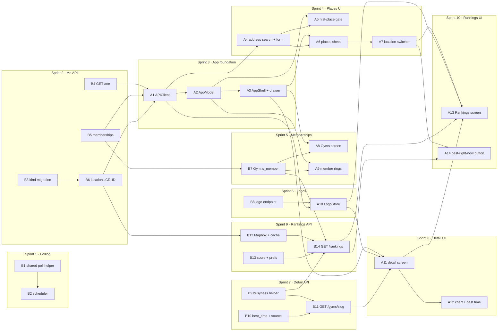

# Boulder Bay — v1 Sprints and Task Dependencies

This breaks `boulder_bay_v1_design.md` into small sprints and numbered tasks. The design says
*what* to build and why; this file says *in what order*. Section references (§) point to the
design doc.

- **Task IDs:** `B` is a backend task, `A` an app task. Each task is roughly one self-contained
  change that passes CI on its own.
- **Dependencies are hard dependencies.** The task needs the other one's code or API contract
  to be merged first. Anything not linked can run in parallel.
- **A sprint is done** when every task in it has merged and its "done when" check passes against
  the hosted database.

### When a sprint is done

Closing a sprint is part of the sprint, not a follow-up. In the same change that finishes it:

1. **Check it off.** Tick each of its tasks and the sprint itself in the [checklist](#checklist).
   - **Tasks:** tick a task as soon as it is done, meaning its code is merged into the working
     branch and CI's checks pass. No PR is needed.
   - **Sprints:** tick a sprint only once its "done when" check passes. If every task is done
     but the check hasn't been run yet (it needs the hosted database, a real scheduler run, a
     device), leave the sprint unticked. Write in its notes what the check still needs, and
     tell the user which sprints are waiting on testing.
2. **Write its entry in the [sprint log](#sprint-log)**, with two parts:
   - **What was done:** the parts that matter later, not a changelog. Name the branches or
     commits, any migration revision it applied, and anywhere the work differs from the design doc or this
     plan (a renamed route, a dropped field, a task split or merged).
   - **Findings for later sprints:** anything a future sprint needs to know before it starts:
     gotchas, contract details the next task depends on, assumptions that turned out wrong,
     work that was deferred and where it went. Name the sprint or task it affects (e.g. "affects
     B14"). Write "None" when there are none, so an empty section reads as checked, not
     forgotten.
3. **Read the log before starting a sprint.** Earlier findings override the plan below where
   they conflict; update the affected task row when they do. Copy each finding that a task
   still open depends on into the **Notes for open tasks** list under that task's sprint
   table, so it is in front of whoever picks the task up. Drop a note once its task merges.

---

## Checklist

- [ ] **Sprint 1 — Automatic polling**
  - [x] B1 Shared poll helper
  - [x] B2 Scheduler
- [ ] **Sprint 2 — Profile, memberships and places API**
  - [x] B3 `saved_locations.kind` migration
  - [x] B4 `GET /api/me`
  - [x] B5 Memberships
  - [x] B6 Saved locations CRUD
- [ ] **Sprint 3 — App foundation**
  - [ ] A1 `APIClient`
  - [ ] A2 `AppModel`
  - [ ] A3 `AppShell` + drawer
- [ ] **Sprint 4 — Places in the app**
  - [ ] A4 Address search + place form
  - [ ] A5 First-place gate
  - [ ] A6 Places sheet
  - [ ] A7 Location switcher
- [ ] **Sprint 5 — Memberships**
  - [x] B7 `Gym.is_member`
  - [ ] A8 Gyms screen
  - [ ] A9 Member pin rings
- [ ] **Sprint 6 — Logos**
  - [x] B8 Logo endpoint
  - [ ] A10 `LogoStore` + `LogoImage`
- [x] **Sprint 7 — Gym detail, backend**
  - [x] B9 Shared busyness helper
  - [x] B10 `best_time()` + `ForecastPoint.source`
  - [x] B11 `GET /api/gyms/{slug}`
- [ ] **Sprint 8 — Gym detail, app**
  - [ ] A11 Detail screen
  - [ ] A12 Forecast chart + best-time card
- [ ] **Sprint 9 — Rankings, backend**
  - [ ] B12 Mapbox client + travel-time cache
  - [x] B13 `score()` + ranking prefs
  - [ ] B14 `GET /api/rankings`
- [ ] **Sprint 10 — Rankings, app**
  - [ ] A13 Rankings screen
  - [ ] A14 Best-right-now button
- [ ] **Sprint 11 — v1 wrap-up**
  - [ ] X1 On-device walkthrough
  - [ ] X2 Docs marked as built
  - [ ] X3 *(optional)* `last_successful_poll_at` on `/health`

---

## Sprints

### Sprint 1 — Automatic polling
**Goal:** snapshots start accumulating on their own. **Done when:** a FastAPI run with
`SCHEDULER_ENABLED=true` writes snapshots at :00 and :30 for open gyms only.

| ID | Task | Depends on | Design |
|---|---|---|---|
| B1 | Move `load_gyms` into `scrape/poll.py`; extract a shared "load → filter open → poll" helper; CLI uses it and gains `--open-only` | — | §8 |
| B2 | `scrape/scheduler.py`: tick truncation, open-gym filter, `poll_tick` that never raises; `lifespan` wiring; `SCHEDULER_ENABLED` setting; README run notes (one worker, no `--reload`) | B1 | §8 |

**Notes for open tasks** (from merged work, see the [sprint log](#sprint-log)):
- **Done check (open):** both tasks are merged, but nobody has run the scheduler yet. Run
  FastAPI with `SCHEDULER_ENABLED=true`, one worker and no `--reload`, on a host with Chromium
  and the signed-in scrape profile. Then confirm that snapshots land at :00 and :30 for open
  gyms only. Tick the sprint once that works.

### Sprint 2 — Profile, memberships and places API
**Goal:** the three `/api/me` areas stop returning 501. **Done when:** every `/api/me` route
works against the hosted database, and the `kind` migration is applied and recorded in the docs.

| ID | Task | Depends on | Design |
|---|---|---|---|
| B3 | Migration: `saved_locations.kind` + one-home / one-work partial indexes; models, `test_models.py`, `backend/CLAUDE.md`, schema §2.7 / §8, root revision pointer | — | §3 |
| B4 | `GET /api/me` (`services/me.py`) | — | §4 |
| B5 | Memberships: `GET`, idempotent `POST` / `DELETE /{slug}`, 404 on unknown slug | — | §4 |
| B6 | Saved locations CRUD with `kind`: first place becomes default, promote order, last-place 409, delete-default promotion, lat/lng change clears `travel_times`, constraint-name → 409 messages | B3 | §4 |

**Notes for open tasks** (from merged work, see the [sprint log](#sprint-log)):
- **Done check (open):** all four tasks are merged, and revision `75ffc45ed87e` was applied
  on 2026-10-22 and recorded in the docs. What's left is to exercise every `/api/me` route
  against the hosted database: idempotent memberships, the 409s, delete-default promotion and
  the last-place 409.
- **Known gap:** two concurrent "first place" creates can both try to become the default. The
  loser hits `saved_locations_one_default_idx`, which isn't in B6's 409 map, so it gets a 500.
  Adding it to `CONFLICT_MESSAGES` in `services/locations.py` would make it a 409.

### Sprint 3 — App foundation
**Goal:** the app has a real shell to put screens in. **Done when:** after signing in, the
hamburger menu switches between Map and two placeholder screens, and Sign out works from the
drawer.

| ID | Task | Depends on | Design |
|---|---|---|---|
| A1 | `APIClient`: `post` / `patch` / `delete`, 204 handling, `APIError.conflict`; typed calls for `/api/me`, memberships, locations; decoding tests | B4, B5, B6 | §9 Networking |
| A2 | `AppModel`: profile, locations, selected location, memberships, `selectedHour` (moved out of `MapViewModel`); `bootstrap()`; optimistic membership toggle | A1 | §9 Shared state |
| A3 | `AppShell`: `NavigationStack` + `AppRoute`, hamburger button, drawer (avatar, Sign out, Map / Rankings / Gyms rows), placeholder Rankings and Gyms screens; remove the temporary sign-out overlay; drawer snapshot test | A2 | §9 Root and shell |

**Notes for open tasks** (from merged work, see the [sprint log](#sprint-log)):
- **A1, `/api/me`:** returns `{"data": {id, display_name}}`, or 404 `"Profile not found"`.
- **A1, memberships:** use the path parameter `gym_slug`.
  - `GET /api/me/memberships` returns `{"data": [slug, ...]}`, ordered by gym name.
  - `POST` and `DELETE /api/me/memberships/{gym_slug}` return 204 with an empty body, and
    both are idempotent.
  - An unknown or inactive slug returns 404 `"Gym not found"`.
- **A1, saved locations:** `SavedLocation` is `{id, label, address|null, latitude, longitude,
  is_default, kind}`, where `kind` is `home` / `work` / `other`. The Swift `SavedLocation` has
  no `kind` yet; add it.
  - `GET /api/me/locations` returns 200, in creation order.
  - `POST` returns 201. Its body is `{label, kind, address?, latitude, longitude,
    make_default?}`, and unknown fields get a 422.
  - `GET`, `PATCH` and `DELETE /api/me/locations/{location_id}` return 200, 200 and 204.
  - A missing id, or another user's, returns 404 `"Location not found"`.
  - Deleting your only place returns 409 `"You can't delete your only place"`.
  - The other 409s are `"You already have a place with that label"`,
    `"You already have a home"`, `"You already have a work place"` and
    `"Kind must be home, work or other"`.
  - In a `PATCH`, an explicit `null` leaves the field unchanged, except `address`, where it
    clears the address.
- **A1, forecast decoding:** add `let source: BusynessSource?` to the Swift `ForecastPoint`,
  and `"source"` to the forecast fixtures in `APIResponseModelDecodingTests.swift`. The
  backend added it in B10.
- **A1, already decoded:** `Gym.isMember` was added to the Swift `Gym` in B7, so it needs no
  change.

### Sprint 4 — Places in the app
**Goal:** users can manage places, and a new user can't get past onboarding without adding one.
**Done when:** a fresh account adds a first place, then adds, edits, deletes and switches places
from both the drawer and the switcher.

| ID | Task | Depends on | Design |
|---|---|---|---|
| A4 | Address search (`MKLocalSearchCompleter` → `MKLocalSearch`) and the shared place form with the kind-availability rules | A1 | §9 Places |
| A5 | `FirstPlaceView` + the fourth `RootView` gate | A2, A4 | §9 Root and shell |
| A6 | `PlacesView` sheet: list, kind icons, default tag, swipe to delete (not on the last place), "Make default"; opened from the drawer's "Your places" row | A3, A4 | §9 Places |
| A7 | `LocationSwitcher` chip on the map, with "Edit places…" opening A6; the map flies to the chosen place | A6 | §9 Places |

### Sprint 5 — Memberships
**Goal:** the Gyms screen works, and member gyms stand out on the map. **Done when:** adding a
gym on the Gyms screen puts a clay ring on its pin.

| ID | Task | Depends on | Design |
|---|---|---|---|
| B7 | `Gym.is_member` on `/api/gyms` (contract change on both sides) | B5 | §10 |
| A8 | Gyms screen: "Your gyms" list, search over all 16, Add / Added toggles | A3, B7 | §9 Gyms screen |
| A9 | Member pin rings, with member pins drawn on top; update pin snapshots | A2, B7 | §9 Map additions |

**Notes for open tasks** (from merged work, see the [sprint log](#sprint-log)):
- **A8 / A9, membership flag:** `GET /api/gyms` returns `is_member` for the caller, and the
  Swift `Gym` already decodes it as `isMember`. `GET /api/gyms/{slug}` sets it too (`gym.is_member`).
- **A8, toggling:** use `POST` / `DELETE /api/me/memberships/{gym_slug}`. Both return 204 and
  are idempotent, so an optimistic toggle can simply retry.
- **A9, snapshots:** previews and snapshot tests build `Gym(..., isMember: false)` today. Add a
  member case when the ring lands.

### Sprint 6 — Logos
**Goal:** real logos everywhere a gym chip appears. **Done when:** logos load once per launch
and a repeat request returns 304.

| ID | Task | Depends on | Design |
|---|---|---|---|
| B8 | `GET /api/gyms/{slug}/logo` with ETag, 304, `Cache-Control`; fill in `logo_url` | — | §5 |
| A10 | `LogoStore` actor (in memory, no disk cache, deduplicated requests) and `LogoImage` with the initials placeholder and a tint option | A1, B8 | §9 Logos |

**Notes for open tasks** (from merged work, see the [sprint log](#sprint-log)):
- **A10, auth:** the logo route needs the bearer token, so `LogoStore` must send it.
- **A10, URLs:** `Gym.logo_url` is an absolute URL, or null when the gym has no logo. Show the
  initials placeholder for null.
- **A10, caching:**
  - Responses carry `ETag: "<sha256>"` and `Cache-Control: private, max-age=86400`.
  - Send `If-None-Match` to get a 304 with an empty body; matching is weak, and a list or `*`
    is accepted.
  - A 404 (`"Gym logo not found"`) comes back for an unknown or inactive gym, or a gym with no
    logo.

### Sprint 7 — Gym detail, backend
**Goal:** the detail endpoint stops returning 501. **Done when:**
`GET /api/gyms/{slug}?at=` returns hours, rates, links, a forecast and a best time that agree
with the map for the same `at`.

| ID | Task | Depends on | Design |
|---|---|---|---|
| B9 | Refactor: pull busyness loading and resolving out of `list_gyms` into a shared helper, keeping the query bound | — | §6 Refactor |
| B10 | `ForecastPoint.source`; `best_time()` as a pure function with table tests | — | §6 |
| B11 | `GET /api/gyms/{slug}`: the local day's forecast points and best time; 404 / 422 cases | B9, B10 | §6 |

### Sprint 8 — Gym detail, app
**Goal:** tapping a gym anywhere opens its detail screen. **Done when:** detail opens from the
map card and from the Gyms screen, and every section in design §9 renders.

| ID | Task | Depends on | Design |
|---|---|---|---|
| A11 | `GymDetailView` + view model; `GymRoute` destination on the shell; header, address → Apple Maps, hours, busyness, rates, waiver and website links; opened from the map card and Gyms rows | A3, A10, B11 | §9 Gym detail |
| A12 | Forecast chart (Swift Charts) and best-time card; detail snapshot tests | A11 | §9 Gym detail |

**Notes for open tasks** (from merged work, see the [sprint log](#sprint-log)):
- **A11, response:** `GET /api/gyms/{slug}?at=` returns `{"data": GymDetail}`, with these
  fields:
  - `gym`: the same `Gym` as the list, with `busyness`, `logo_url` and `is_member`.
  - `address`, `timezone`, `website_url`, `waiver_url`: each may be null.
  - `hours`: `[{day_of_week, opens_at, closes_at}]`, sorted by day.
  - `rates`: `{day_pass_cents, day_pass_peak_cents, peak_starts_at, monthly_cents}`, each
    nullable.
  - `forecast`: `{date, timezone, points, best_time}`.
- **A11, errors:** 404 `"Gym not found"` for an unknown or inactive slug, and 422 for an `at`
  without a timezone offset.
- **A12, forecast points:** points exist only for hours the gym is open, and they follow the
  gym's local day. A DST day can have 23 or 25 hourly slots, so key the chart by `starts_at`,
  not by hour index.
  - `source` is `observed` for finished hours, `live` for the current hour, and `forecast`
    for later hours. It is null, with a null `busy_pct`, when there is no data; never draw
    that as 0.
  - `best_time` can be null (late in the day, or a closed day).
  - The Swift `ForecastPoint` still lacks `source`; see the A1 note.

### Sprint 9 — Rankings, backend
**Goal:** rankings stop returning 501. **Done when:** rankings for a place return correct
scores, and still work with `MAPBOX_TOKEN` unset (fallback travel times).

| ID | Task | Depends on | Design |
|---|---|---|---|
| B12 | `services/travel.py`: Mapbox Matrix client, `travel_times` cache freshness, haversine fallback; `RANKING_RADIUS_METERS` setting | B6 | §7 Stage 2 |
| B13 | `services/ranking.py`: `score()` with mockup-number tests; lazy `ranking_prefs` row | — | §7 Scoring |
| B14 | `GET /api/rankings?location_id=`: `ST_DWithin` prefilter, the new one-location `Rankings` contract, `RankedGym.is_member` removed; 404 / 409 / default-location cases | B7, B9, B12, B13 | §7, §10 |

**Notes for open tasks** (from merged work, see the [sprint log](#sprint-log)):
- **B14, busyness:** fetch gyms with the `ST_DWithin` prefilter, then call
  `load_busyness_inputs` (B9) on those rows. It takes three queries however many gyms there
  are.
- **B14, scoring:** use `score(*, busy_pct, is_open, travel_minutes, is_member, weights)` from
  `services/ranking.py`.
  - Get `weights` from `RankingWeights.from_prefs(await get_or_create_ranking_prefs(session,
    user_id))`.
  - That helper doesn't commit, so commit after it, because it may have inserted the row.
  - `score()` returns an unrounded float; round it at the API layer if the contract needs it.
- **B14, membership:** `Gym.is_member` exists now (B7), so drop `RankedGym.is_member` as
  planned. Load the caller's memberships with one query, the way `list_gyms` does (`gym_id`s
  into a set), and use that set for both `score(is_member=...)` and the `Gym` you build.
  `to_api_gym` now requires `is_member`.
- **B14, `at`:** use `requested_instants(at, now)` from `services/gyms.py` for the default
  and the naive-`at` check, instead of a third copy.
- **B12, cache:** B6's `update_location` already deletes a location's `travel_times` rows when
  its latitude or longitude changes. Delete cascades the rest, so B12 only has to check
  freshness.

### Sprint 10 — Rankings, app
**Goal:** the core v1 feature. **Done when:** the Rankings screen and the map's best-pick
button agree for the same place and hour.

| ID | Task | Depends on | Design |
|---|---|---|---|
| A13 | Rankings screen: switcher + time header, best-pick card (tinted logo, "why" line), ranked rows that push detail, pull to refresh; snapshot tests | A7, A10, A11, B14 | §9 Rankings screen |
| A14 | Map "Best right now / Best at 7 PM" button: fetch rankings, select and fly to rank 1 | A7, B14 | §9 Map additions |

### Sprint 11 — v1 wrap-up
**Goal:** v1 is complete and the docs say so. **Done when:** a full walkthrough on a device
works, and nothing in the docs describes a 501.

| ID | Task | Depends on | Design |
|---|---|---|---|
| X1 | On-device walkthrough of every flow (sign up → first place → map → detail → gyms → rankings → sign out); fix what it finds | all above | — |
| X2 | Docs: README, both `CLAUDE.md` files, mark the plan and design as built | X1 | — |
| X3 | *(optional)* `last_successful_poll_at` on `/health` | B2 | §11 |

---

## Dependency tree

GitHub renders this diagram. Arrows point from a prerequisite to the task that needs it.



The same graph as a list. **Start here** marks tasks with no prerequisites; each arrow lists
what a task unblocks.

```text
Start here: B1, B3, B4, B5, B8, B9, B10, B13

B1  → B2
B3  → B6
B4  → A1
B5  → A1, B7
B6  → A1, B12
B7  → A8, A9, B14
B8  → A10
B9  → B11, B14
B10 → B11
B11 → A11
B12 → B14
B13 → B14
B14 → A13, A14
A1  → A2, A4, A10
A2  → A3, A5, A9
A3  → A6, A8, A11
A4  → A5, A6
A6  → A7
A7  → A13, A14
A10 → A11, A13
A11 → A12, A13
A13, A14, A12, A8, A9, A5, B2 → X1 → X2
B2  → X3 (optional)
```

### Where things stand (2026-10-22)

- **Merged:** B1–B11 and B13, on `claude/great-hamilton-jbc84m`. Not on `main` yet.
- **Sprints done:** Sprint 7.
- **Ready to start now:**
  - **A1:** B4, B5 and B6 are merged, so the critical path's next step is unblocked.
  - **B12:** B6 is merged.
  - **X3:** B2 is merged.
- **Blocked:**
  - **B14:** waits on B12.
  - **A2 onward:** wait on A1.
  - **A10:** waits on A1.
- **Done checks still open:**
  - **Sprint 1:** a real scheduler run.
  - **Sprint 2:** exercise `/api/me` on the hosted database (`75ffc45ed87e` is applied).

## Critical path

The longest chain, and the sequence that sets the schedule:

```text
B3 → B6 → A1 → A2 → A3 → A6 → A7 → A13 → X1 → X2
```

Everything else can be done alongside it:

- **Backend, while the app track runs (sprints 3–4):** B1–B2, B7, B8, B9–B11, B12–B14. None of
  them waits on the app, so the backend for sprints 5–9 can be finished by the end of sprint 4.
- **App, off the critical path:** A4 can start as soon as A1 lands, alongside A2–A3. A8, A9, A10
  and A11 slot in once their backend task is merged.
- **Sprint 1 blocks nothing.** It goes first only so that data starts accumulating; it can move
  later without delaying anything.

---

## Sprint log

One entry per finished sprint, in the order they finished, following
[When a sprint is done](#when-a-sprint-is-done). A sprint with merged tasks but still open
work gets an *in progress* entry, which becomes its normal entry when the sprint closes. Use
this shape:

```markdown
### Sprint N — <name> (done YYYY-MM-DD)
**What was done:** …
**Findings for later sprints:** … (or "None")
```

*No sprints finished yet.* The in-progress entries below cover the twelve backend tasks
merged into `claude/great-hamilton-jbc84m` on 2026-10-22: B1, B3, B4, B5, B8, B9, B10 and B13
first, then B2, B6, B7 and B11. None of them is on `main` yet, and there are no PRs.

### Sprint 1 — Automatic polling (in progress: B1, B2 merged; done check open)
**What was done:** B1. `load_gyms` moved into `app/scrape/poll.py`, and the new
`load_and_poll(session, open_provider, *, now, slugs=(), open_only=False, dry_run=False)`
does load → filter open → poll. The CLI calls it and gained `--open-only`. Not in the plan:
`PollSummary.no_data` is now false for an empty result list (`all([])` used to make it true,
a false DOM-change alarm whenever every gym was closed).

B2. `app/scrape/scheduler.py` is built on APScheduler, which was already a dependency.
- `create_scheduler()` returns an `AsyncIOScheduler` with one `CronTrigger(minute="0,30")` job
  in UTC, using `max_instances=1`, `coalesce=True` and `misfire_grace_time=300`.
- `poll_tick(session_factory, settings, *, now=None)` truncates to the tick and calls
  `load_and_poll(..., open_only=True)`. It never raises: errors are logged at ERROR, and a
  tick with no open gym logs at DEBUG.
- `lifespan` starts the scheduler only when `SCHEDULER_ENABLED=true`, which defaults to false,
  and shuts it down before disposing the engine.
- The README has the run notes: one worker, no `--reload`, Chromium plus the signed-in
  profile.

**Findings for later sprints:**
- The done check needs a real run with the scheduler on, which nobody has done yet.
- Affects X3: `poll_tick` is the natural place to record `last_successful_poll_at`.
- `load_and_poll` commits after loading, so the read transaction doesn't idle through the
  scrape. Its `open_provider` factory is called only when some gym is open, so an all-closed
  tick never launches Chromium.
- `open_during` now lives in `app/services/busyness.py` (moved by B10); `poll.py` imports it.

### Sprint 2 — Profile, memberships and places API (in progress: all merged; migration applied; done check open)
**What was done:**
- B3: revision `75ffc45ed87e` (down: `b91e4d2c7a60`), hand-written. It adds
  `saved_locations.kind text not null default 'other'`, the check `saved_locations_kind_valid`,
  and the partial unique indexes `saved_locations_one_home_idx` / `saved_locations_one_work_idx`
  on `(user_id)`. Existing rows backfill as `other` through the default. Applied to the hosted
  database on 2026-10-22; `alembic current` reports `75ffc45ed87e`.
- B4: `GET /api/me` via `app/services/me.py` (`get_profile`). It returns
  `{"data": {id, display_name}}`, or 404 `"Profile not found"` when the profile row is missing.
- B5: memberships. The service is in `app/services/memberships.py`, not `services/me.py` as
  §4 suggests. `GET /api/me/memberships` returns `{"data": [slug, ...]}` ordered by gym name,
  active gyms only. `POST` / `DELETE /api/me/memberships/{gym_slug}` return 204 with no body,
  are idempotent (`ON CONFLICT DO NOTHING`, and deleting a missing row is fine), and return
  404 `"Gym not found"` for an unknown or inactive slug. The service commits after each
  write, because `get_session` never commits.
- B6: saved locations in `app/services/locations.py`, with `LocationKind` in the API models.
  - **Create:** the first place becomes the default; `make_default` on a later one moves the
    default in the same transaction.
  - **Update:** reads the row `FOR UPDATE`, scoped to the user. A latitude or longitude
    change deletes that location's `travel_times`.
  - **Delete:** locks all of the user's rows, oldest first. Deleting your only place is a 409;
    deleting the default promotes the oldest remaining place.
  - **Constraint names:** read from `IntegrityError.orig` or `orig.__cause__`, because
    SQLAlchemy's asyncpg adapter wraps the error. Any constraint not in the map is re-raised
    as a 500.
  - The `me` router's router-wide 501 is gone.

**Findings for later sprints:**
- Affects A1: the full saved-location contract is in Sprint 3's notes. The Swift
  `SavedLocation` has no `kind` yet.
- Open: `saved_locations_one_default_idx` isn't in the 409 map, so concurrent first creates
  can return a 500.
- Testing gotcha: `created_at` defaults to `now()`, which is the transaction's start time.
  Places created inside one transaction all tie on `created_at`, so their order (and which
  one a deleted default promotes) falls to the random `id`. Real requests are separate
  transactions, so the API is fine, but a test that runs several creates in one transaction
  must stagger `created_at` itself.
- Affects A1: the membership contract is in Sprint 3's notes too.
- Tests check the SQL the code builds, not a real Postgres. Idempotency and the partial
  indexes are only proven once the routes run against the hosted database (the migration
  itself is applied).

### Sprint 5 — Memberships (in progress: B7 merged; A8, A9 open)
**What was done:** B7. `Gym.is_member: bool` is required on the API model, and `list_gyms`
takes `user_id`. It adds one query for the caller's membership `gym_id`s, so the list is now
five queries. The Swift `Gym` decodes `isMember`, and its fixtures, previews and snapshot
inputs pass it. When B7 merged with B11, gym detail gained `user_id` and its own membership
query (seven queries in all), so `gym.is_member` is set on the detail too.

**Findings for later sprints:**
- Affects B14: `to_api_gym` requires `is_member`, and the rankings payload's `gym` already
  carries it. `RankedGym.is_member` is still there for B14 to remove.
- Affects A8 / A9: see Sprint 5's notes.

### Sprint 6 — Logos (in progress: B8 merged, A10 open)
**What was done:** B8. `GET /api/gyms/{slug}/logo` serves `gym_logos` bytes with
`ETag: "<sha256>"`, `Cache-Control: private, max-age=86400` and `Content-Type` from the row.
`Gym.logo_url` is now an absolute URL to that route, or null for a gym without a logo.
Differences from §5: the route also 404s for an inactive gym, and the service takes a
`logo_url_for` callback instead of the `Request`.

**Findings for later sprints:**
- Affects A10: `If-None-Match` is compared weakly and accepts a list or `*`. A 304 has an empty
  body and repeats `ETag` and `Cache-Control`. The 404 (`"Gym logo not found"`) is checked
  before `If-None-Match`. The route needs the bearer token like every other route, so
  `LogoStore` must send it.

### Sprint 7 — Gym detail, backend (done 2026-10-22)
**What was done:**
- B9: `load_busyness_inputs(session, gyms, *, at, now) -> BusynessInputs` in
  `app/services/gyms.py`. It takes three queries for any number of gyms (none for an empty
  list), and `BusynessInputs.resolve_for(gym)` resolves one gym. `list_gyms` uses it; it was
  four queries after B9 and is five since B7 added the membership query. Differences from §6: it lives in `services/gyms.py` rather than
  `services/busyness.py`, and `resolve_for` is a method.
- B10: `best_time(at, *, timezone, hours, curve) -> ForecastPoint | None` in
  `app/services/busyness.py`. It picks the lowest-`busy_pct` hour after `at`'s local hour,
  within the same local day, that is at least partly open and has a curve row. Ties go to the
  earliest hour, and 0% counts as data. `ForecastPoint.source` was added
  (`live` / `observed` / `forecast`, or null for a gap). `open_during` moved here from
  `scrape/poll.py`.
- B11: `get_gym_detail(session, slug, *, user_id, at, now, logo_url_for)` in
  `services/gyms.py` takes seven queries:
  - 1: the gym.
  - 2–4: `load_busyness_inputs` for the current busyness, so it matches the list exactly.
  - 5: that local weekday's curve.
  - 6: the day's snapshots plus the live window.
  - 7: the caller's membership (added when B7 and B11 merged).

  Other changes:
  - New `local_day()` and `forecast_points()` in `services/busyness.py`.
  - `resolve_open_busyness()` was split out of `resolve_busyness()` so an hour where the gym
    opens partway through isn't blanked. This differs from §6, which says to call
    `resolve_busyness` per point.
  - `requested_instants()` handles the default `at` and the naive-`at` 422. `list_gyms` still
    has its own copy of that check.

**Done check:** passed on 2026-10-22 against the hosted database. At one shared `at`, every
gym's `GET /api/gyms/{slug}` `gym` equalled its `GET /api/gyms` entry. Every open gym had
forecast points, and every `best_time` was a later `forecast` hour or null. The unknown-slug
404 and the naive-`at` 422 also held. In a sample (`bm-berkeley`) there were 15 points with
`forecast` and `live` sources, and 7 hours rows. In the same run, the logo route returned a
PNG with an ETag and then a 304, and all 16 gyms have a `logo_url`.

**Findings for later sprints:**
- Affects A11 / A12: response shape and point rules are in Sprint 8's notes.
- No `observed` points showed up yet, because snapshots have only just started
  accumulating. Expect them once the scheduler has been running.
- Pre-existing, low risk: `best_time` builds its hour with `local.replace(hour=...)`, which
  could be off by an hour on a DST-transition hour. Gyms open at 6 am or later, so it can't
  happen today.
- Affects A1 / A11 / A12: the Swift `ForecastPoint` has no `source` yet (see the A1 note).
- Affects B14: reuse `requested_instants()` rather than adding a third naive-`at` check.

### Sprint 9 — Rankings, backend (in progress: B13 merged; B12, B14 open)
**What was done:** B13. `app/services/ranking.py` with the pure
`score(*, busy_pct, is_open, travel_minutes, is_member, weights=DEFAULT_WEIGHTS)`, which is
100 − w_crowd·crowd − w_travel·min(travel, cap) + member_boost − closed_penalty. A closed gym
has crowd 0, an open gym with unknown busyness counts as 50, and a closed member keeps the
boost. `RankingWeights.from_prefs(row)` converts the Decimal columns.
`get_or_create_ranking_prefs(session, user_id)` inserts with `ON CONFLICT DO NOTHING`, then
selects; it does not commit.

**Findings for later sprints:**
- Affects B14: how to put the prefilter, busyness loader, weights and prefs row together is
  in Sprint 9's notes.
