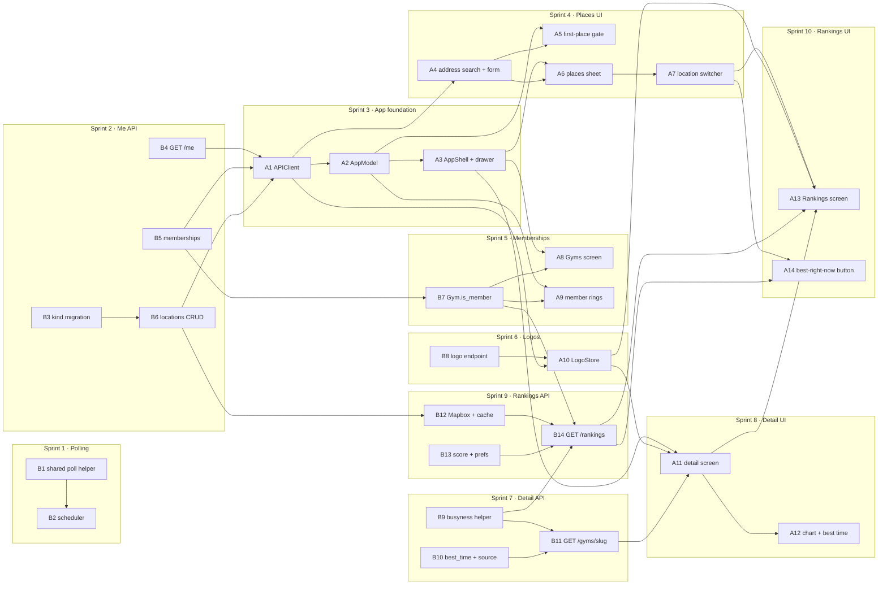

# Boulder Bay — v1 Sprints and Task Dependencies

This breaks `boulder_bay_v1_design.md` into small sprints and numbered tasks. The design says
*what* to build and why; this file says *in what order*. Section references (§) point to the
design doc.

- **Task IDs:** `B` is a backend task, `A` an app task. Each task is roughly one self-contained
change that passes CI on its own.
- **Dependencies are hard dependencies.** The task needs the other one's code or API contract
to be merged first. Anything not linked can run in parallel.
- **A sprint is done** when every task in it has merged and its "done when" check passes against
the hosted database.

### When a sprint is done

Closing a sprint is part of the sprint, not a follow-up. In the same change that finishes it:

1. **Check it off.** Tick each of its tasks and the sprint itself in the [checklist](#checklist).
   - **Tasks:** tick a task as soon as it is done, meaning its code is merged into the working
    branch and CI's checks pass. No PR is needed.
   - **Sprints:** tick a sprint only once its "done when" check passes. If every task is done
   but the check hasn't been run yet (it needs the hosted database, a real scheduler run, a
   device), leave the sprint unticked. Write in its notes what the check still needs, and
   tell the user which sprints are waiting on testing.
2. **Write its entry in the [sprint log](#sprint-log)**, with two parts:
   - **What was done:** the parts that matter later, not a changelog. Name the branches or
    commits, any migration revision it applied, and anywhere the work differs from the design doc or this
    plan (a renamed route, a dropped field, a task split or merged).
   - **Findings for later sprints:** anything a future sprint needs to know before it starts:
   gotchas, contract details the next task depends on, assumptions that turned out wrong,
   work that was deferred and where it went. Name the sprint or task it affects (e.g. "affects
   B14"). Write "None" when there are none, so an empty section reads as checked, not
   forgotten.
3. **Read the log before starting a sprint.** Earlier findings override the plan below where

   they conflict; update the affected task row when they do. Copy each finding that a task
    still open depends on into the **Notes for open tasks** list under that task's sprint
    table, so it is in front of whoever picks the task up. Drop a note once its task merges.

---

## Checklist

- [x] **Sprint 1 — Automatic polling**
  - [x] B1 Shared poll helper
  - [x] B2 Scheduler
- [x] **Sprint 2 — Profile, memberships and places API**
  - [x] B3 `saved_locations.kind` migration
  - [x] B4 `GET /api/me`
  - [x] B5 Memberships
  - [x] B6 Saved locations CRUD
- [ ] **Sprint 3 — App foundation**
  - [x] A1 `APIClient`
  - [x] A2 `AppModel`
  - [ ] A3 `AppShell` + drawer
- [ ] **Sprint 4 — Places in the app**
  - [x] A4 Address search + place form
  - [ ] A5 First-place gate
  - [ ] A6 Places sheet
  - [ ] A7 Location switcher
- [ ] **Sprint 5 — Memberships**
  - [x] B7 `Gym.is_member`
  - [ ] A8 Gyms screen
  - [ ] A9 Member pin rings
- [ ] **Sprint 6 — Logos**
  - [x] B8 Logo endpoint
  - [x] A10 `LogoStore` + `LogoImage`
- [x] **Sprint 7 — Gym detail, backend**
  - [x] B9 Shared busyness helper
  - [x] B10 `best_time()` + `ForecastPoint.source`
  - [x] B11 `GET /api/gyms/{slug}`
- [ ] **Sprint 8 — Gym detail, app**
  - [ ] A11 Detail screen
  - [ ] A12 Forecast chart + best-time card
- [ ] **Sprint 9 — Rankings, backend**
  - [x] B12 Mapbox client + travel-time cache
  - [x] B13 `score()` + ranking prefs
  - [x] B14 `GET /api/rankings`
- [ ] **Sprint 10 — Rankings, app**
  - [ ] A13 Rankings screen
  - [ ] A14 Best-right-now button
- [ ] **Sprint 11 — v1 wrap-up**
  - [ ] X1 On-device walkthrough
  - [ ] X2 Docs marked as built
  - [x] X3 *(optional)* `last_successful_poll_at` on `/health`

---

## Sprints

### Sprint 1 — Automatic polling

**Goal:** snapshots start accumulating on their own. **Done when:** a FastAPI run with
`SCHEDULER_ENABLED=true` writes snapshots at :00 and :30 for open gyms only.

| ID | Task | Depends on | Design |
|---|---|---|---|
| B1 | Move `load_gyms` into `scrape/poll.py`; extract a shared "load → filter open → poll" helper; CLI uses it and gains `--open-only` | — | §8 |
| B2 | `scrape/scheduler.py`: tick truncation, open-gym filter, `poll_tick` that never raises; `lifespan` wiring; `SCHEDULER_ENABLED` setting; README run notes (one worker, no `--reload`) | B1 | §8 |

### Sprint 2 — Profile, memberships and places API

**Goal:** the three `/api/me` areas stop returning 501. **Done when:** every `/api/me` route
works against the hosted database, and the `kind` migration is applied and recorded in the docs.

| ID | Task | Depends on | Design |
|---|---|---|---|
| B3 | Migration: `saved_locations.kind` + one-home / one-work partial indexes; models, `test_models.py`, `backend/CLAUDE.md`, schema §2.7 / §8, root revision pointer | — | §3 |
| B4 | `GET /api/me` (`services/me.py`) | — | §4 |
| B5 | Memberships: `GET`, idempotent `POST` / `DELETE /{slug}`, 404 on unknown slug | — | §4 |
| B6 | Saved locations CRUD with `kind`: first place becomes default, promote order, last-place 409, delete-default promotion, lat/lng change clears `travel_times`, constraint-name → 409 messages | B3 | §4 |

### Sprint 3 — App foundation

**Goal:** the app has a real shell to put screens in. **Done when:** after signing in, the
hamburger menu switches between Map and two placeholder screens, and Sign out works from the
drawer.

| ID | Task | Depends on | Design |
|---|---|---|---|
| A1 | `APIClient`: `post` / `patch` / `delete`, 204 handling, `APIError.conflict`; typed calls for `/api/me`, memberships, locations; decoding tests | B4, B5, B6 | §9 Networking |
| A2 | `AppModel`: profile, locations, selected location, memberships, `selectedHour` (moved out of `MapViewModel`); `bootstrap()`; optimistic membership toggle | A1 | §9 Shared state |
| A3 | `AppShell`: `NavigationStack` + `AppRoute`, hamburger button, drawer (avatar, Sign out, Map / Rankings / Gyms rows), placeholder Rankings and Gyms screens; remove the temporary sign-out overlay; drawer snapshot test | A2 | §9 Root and shell |

**Notes for open tasks** (from merged work, see the [sprint log](#sprint-log)):

- **A3, tasks to move:** `RootView`'s signed-in branch (still the temporary `MapView` with
the sign-out overlay) runs `.task { await appModel.bootstrap() }` and
`.task { await appModel.listenForPolls() }`. Move both onto `AppShell`, or whatever stays
alive for the signed-in session, so signing out still cancels the Realtime listener. Pass
`container.appModel` down.
- **A3, drawer:** build the avatar and name from `appModel.profile`, which is nil until
`bootstrap()` succeeds. Sign-out needs no `AppModel` call: the next sign-in's `bootstrap()`
clears everything first.
- **A3, errors:** new screens use `APIError.message(for:)`, which shows a `.conflict` message
as it is.

### Sprint 4 — Places in the app

**Goal:** users can manage places, and a new user can't get past onboarding without adding one.
**Done when:** a fresh account adds a first place, then adds, edits, deletes and switches places
from both the drawer and the switcher.

| ID | Task | Depends on | Design |
|---|---|---|---|
| A4 | Address search (`MKLocalSearchCompleter` → `MKLocalSearch`) and the shared place form with the kind-availability rules | A1 | §9 Places |
| A5 | `FirstPlaceView` + the fourth `RootView` gate | A2, A4 | §9 Root and shell |
| A6 | `PlacesView` sheet: list, kind icons, default tag, swipe to delete (not on the last place), "Make default"; opened from the drawer's "Your places" row | A3, A4 | §9 Places |
| A7 | `LocationSwitcher` chip on the map, with "Edit places…" opening A6; the map flies to the chosen place | A6 | §9 Places |

**Notes for open tasks** (from merged work, see the [sprint log](#sprint-log)):

- **A5 / A6, the form:** host `PlaceFormView(model:submitLabel:onSaved:)` from
`Features/Places/`. It has no header or scroll view of its own. Build its model with
`PlaceFormModel(existing:preferredKind:search:create:)` to add a place, or
`PlaceFormModel(editing:existing:search:update:)` to edit one. Pass
`MapKitAddressSearch()` as `search`. The `create` / `update` closures take the request body
and return the saved `SavedLocation`; `apiClient.createLocation` and
`apiClient.updateLocation(id:_:)` fit them directly.
- **A5 / A6, after a write:** call `try await appModel.reloadLocations()` after every create,
update or delete, since the server may move the default. It also keeps or re-picks the
selection.
- **A5, the gate:** check `appModel.state == .loaded` before treating an empty `locations` as
"needs `FirstPlaceView`"; it is empty while loading or failed too. On `.failed(msg)`, show
it with a retry that calls `bootstrap()` again.
- **A6, default:** promote a place with `UpdateSavedLocation(makeDefault: true)`. There is
no call that removes the default from a place; another place has to take it.
- **A6, conflicts:** deleting the only place arrives as `.conflict(<backend message>)`, as do
the rare default-place race ("Your default place changed at the same time. Try again"),
which a plain retry fixes. Show them through `APIError.message(for:)`.
- **A6 / A7, icons:** `LocationKind` has `.title`, `.symbolName` (`house.fill` /
`briefcase.fill` / `mappin`) and `.defaultLabel`.
- **A7, selection:** `appModel.selectLocation(id:)` and `appModel.selectedLocation`.
- **A5 / A6, check on a simulator:** `MapKitAddressSearch` has never run against MapKit; only
its address formatting is unit-tested.

### Sprint 5 — Memberships

**Goal:** the Gyms screen works, and member gyms stand out on the map. **Done when:** adding a
gym on the Gyms screen puts a clay ring on its pin.

| ID | Task | Depends on | Design |
|---|---|---|---|
| B7 | `Gym.is_member` on `/api/gyms` (contract change on both sides) | B5 | §10 |
| A8 | Gyms screen: "Your gyms" list, search over all 16, Add / Added toggles | A3, B7 | §9 Gyms screen |
| A9 | Member pin rings, with member pins drawn on top; update pin snapshots | A2, B7 | §9 Map additions |

**Notes for open tasks** (from merged work, see the [sprint log](#sprint-log)):

- **A8 / A9, membership flag:** `GET /api/gyms` returns `is_member` for the caller, and the
Swift `Gym` already decodes it as `isMember`. `GET /api/gyms/{slug}` sets it too (`gym.is_member`).
- **A8, toggling:** use `APIClient.addMembership(gymSlug:)` / `removeMembership(gymSlug:)`
(A1), which wrap `POST` / `DELETE /api/me/memberships/{gym_slug}`. Both are idempotent, so an
optimistic toggle can simply retry.
- **A8, toggle state (A2):** use `appModel.toggleMembership(gymSlug:)`, not the client
calls directly. It flips `appModel.memberships` at once and rolls back on failure, setting
`membershipError` (show it, then set it back to nil). A second tap while a slug is in
`pendingMemberships` is ignored, so disable that row.
- **A8 / A9, source of truth:** `appModel.memberships` (a `Set` of slugs) is current;
`Gym.isMember` is only as fresh as the last `/api/gyms` load.
- **A8 / A9, open question:** design §9 contradicts itself on where the gym list lives.
"Shared state" keeps it on `MapViewModel`, but "Gyms screen" says it is kept on `AppModel`.
Today it is on `MapViewModel`. Settle this with the user before A8.
- **A9, snapshots:** previews and snapshot tests build `Gym(..., isMember: false)` today. Add a
member case when the ring lands.

### Sprint 6 — Logos

**Goal:** real logos everywhere a gym chip appears. **Done when:** logos load once per launch
and a repeat request returns 304.

| ID | Task | Depends on | Design |
|---|---|---|---|
| B8 | `GET /api/gyms/{slug}/logo` with ETag, 304, `Cache-Control`; fill in `logo_url` | — | §5 |
| A10 | `LogoStore` actor (in memory, no disk cache, deduplicated requests) and `LogoImage` with the initials placeholder and a tint option | A1, B8 | §9 Logos |

### Sprint 7 — Gym detail, backend

**Goal:** the detail endpoint stops returning 501. **Done when:**
`GET /api/gyms/{slug}?at=` returns hours, rates, links, a forecast and a best time that agree
with the map for the same `at`.

| ID | Task | Depends on | Design |
|---|---|---|---|
| B9 | Refactor: pull busyness loading and resolving out of `list_gyms` into a shared helper, keeping the query bound | — | §6 Refactor |
| B10 | `ForecastPoint.source`; `best_time()` as a pure function with table tests | — | §6 |
| B11 | `GET /api/gyms/{slug}`: the local day's forecast points and best time; 404 / 422 cases | B9, B10 | §6 |

### Sprint 8 — Gym detail, app

**Goal:** tapping a gym anywhere opens its detail screen. **Done when:** detail opens from the
map card and from the Gyms screen, and every section in design §9 renders.

| ID | Task | Depends on | Design |
|---|---|---|---|
| A11 | `GymDetailView` + view model; `GymRoute` destination on the shell; header, address → Apple Maps, hours, busyness, rates, waiver and website links; opened from the map card and Gyms rows | A3, A10, B11 | §9 Gym detail |
| A12 | Forecast chart (Swift Charts) and best-time card; detail snapshot tests | A11 | §9 Gym detail |

**Notes for open tasks** (from merged work, see the [sprint log](#sprint-log)):

- **A11, response:** `GET /api/gyms/{slug}?at=` returns `{"data": GymDetail}`, with these
fields:
  - `gym`: the same `Gym` as the list, with `busyness`, `logo_url` and `is_member`.
  - `address`, `timezone`, `website_url`, `waiver_url`: each may be null.
  - `hours`: `[{day_of_week, opens_at, closes_at}]`, sorted by day.
  - `rates`: `{day_pass_cents, day_pass_peak_cents, peak_starts_at, monthly_cents}`, each
  nullable.
  - `forecast`: `{date, timezone, points, best_time}`.
- **A11, errors:** 404 `"Gym not found"` for an unknown or inactive slug, and 422 for an `at`
without a timezone offset.
- **A12, forecast points:** points exist only for hours the gym is open, and they follow the
gym's local day. A DST day can have 23 or 25 hourly slots, so key the chart by `starts_at`,
not by hour index.
  - `source` is `observed` for finished hours, `live` for the current hour, and `forecast`
  for later hours. It is null, with a null `busy_pct`, when there is no data; never draw
  that as 0.
  - `best_time` can be null (late in the day, or a closed day).
  - The Swift `ForecastPoint` decodes `source` since A1.
- **A11, client:** `APIClient` has no `gymDetail(slug:)` call yet; A1 covered only the
`/api/me` routes. A11 adds it.
- **A11, logo:** the header uses `LogoImage(gym: detail.gym, size: 72)`. The store comes from
the environment, so nothing needs passing down.
- **A11, live refresh:** refetch on `.onChange(of: appModel.liveRefreshCount)`. It fires only
while the selected hour is the current one. If detail should refresh at any hour, `AppModel`
needs a second signal; it has none today.

### Sprint 9 — Rankings, backend

**Goal:** rankings stop returning 501. **Done when:** rankings for a place return correct
scores, and still work with `MAPBOX_TOKEN` unset (fallback travel times).

| ID | Task | Depends on | Design |
|---|---|---|---|
| B12 | `services/travel.py`: Mapbox Matrix client, `travel_times` cache freshness, haversine fallback; `RANKING_RADIUS_METERS` setting | B6 | §7 Stage 2 |
| B13 | `services/ranking.py`: `score()` with mockup-number tests; lazy `ranking_prefs` row | — | §7 Scoring |
| B14 | `GET /api/rankings?location_id=`: `ST_DWithin` prefilter, the new one-location `Rankings` contract, `RankedGym.is_member` removed; 404 / 409 / default-location cases | B7, B9, B12, B13 | §7, §10 |

**Notes for open tasks** (from merged work, see the [sprint log](#sprint-log)):

- **Sprint 9 done check:** B14 must pass against the hosted database, both with `MAPBOX_TOKEN` set and unset. Live Mapbox already
works: on 2026-10-23 a rolled-back `travel_minutes` run from a Mission point got real
driving times for all 16 gyms in one request (0.95 s), every row stored route meters, and a
repeat call came from the cache (0.07 s). Driving times differ a lot from the fallback in
both directions (`mv-sf` 30.7 vs 16.0 min, `studio` 62.0 vs 101.2), so rankings will move
when a token is set.

### Sprint 10 — Rankings, app

**Goal:** the core v1 feature. **Done when:** the Rankings screen and the map's best-pick
button agree for the same place and hour.

| ID | Task | Depends on | Design |
|---|---|---|---|
| A13 | Rankings screen: switcher + time header, best-pick card (tinted logo, "why" line), ranked rows that push detail, pull to refresh; snapshot tests | A7, A10, A11, B14 | §9 Rankings screen |
| A14 | Map "Best right now / Best at 7 PM" button: fetch rankings, select and fly to rank 1 | A7, B14 | §9 Map additions |

**Notes for open tasks** (from merged work, see the [sprint log](#sprint-log)):

- **A13 / A14, client:** `APIClient` has no rankings call yet. The Swift `Rankings` /
`LocationRankings` models still have the old shape, so the app is out of step with the
backend until A13 lands. The app's CI doesn't call the backend, so nothing fails meanwhile.
Reshape `Rankings` to `{at, location: SavedLocation, rankedGyms: [RankedGym]}`, delete
`LocationRankings`, drop `RankedGym.isMember` (read `rankedGym.gym.isMember`), and update the
decoding fixture.
- **A13 / A14, request:** `GET /api/rankings?location_id=<uuid>&at=<datetime>&limit=<1..16>`,
all optional. Always send `location_id` (lowercased) for the selected place. Send `at` with an
offset (`appModel.date(forHour: appModel.selectedHour)`), or leave it out for now; it comes back
with the same offset.
- **A13 / A14, response:** `ranked_gyms` items are `{rank, score, travel_minutes, gym}`, where
`gym` is the list's `Gym`. `score` is unrounded, so round it for display. `travel_minutes` has
at most 2 decimals. There is no `provider` field; add one to `RankedGym` if the app wants to
mark fallback times. A closed gym is still ranked, just low (−60), so show "Closed" from
`gym.busyness.is_open`. An empty list is valid (nothing within 50 mi) and needs an empty
state.
- **A13 / A14, errors:** 404 `"Location not found"` means the selected place is stale (deleted on
another device): reload places and fall back to the default. 409 `"A saved location is
required"` happens only without `location_id`. A naive `at` is 422.
- **A13, header and refresh:** use `appModel.isSelectedHourNow` for "Live" vs "Forecast", and
refetch on `.onChange(of: appModel.liveRefreshCount)`.
- **A13, best pick:** `LogoImage(gym:size: 52, tint: Theme.onBrandPrimaryIcon)`; list rows use
36–38.

### Sprint 11 — v1 wrap-up

**Goal:** v1 is complete and the docs say so. **Done when:** a full walkthrough on a device
works, and nothing in the docs describes a 501.

| ID | Task | Depends on | Design |
|---|---|---|---|
| X1 | On-device walkthrough of every flow (sign up → first place → map → detail → gyms → rankings → sign out); fix what it finds | all above | — |
| X2 | Docs: README, both `CLAUDE.md` files, mark the plan and design as built | X1 | — |
| X3 | *(optional)* `last_successful_poll_at` on `/health` | B2 | §11 |

**Notes for open tasks** (from merged work, see the [sprint log](#sprint-log)):

- **X2, `/health`:** the README and `backend/CLAUDE.md` already describe the X3 shape
(`status`, `last_successful_poll_at`, `poll_state`); check they still match when marking the
docs as built.

---

## Dependency tree

GitHub renders this diagram. Arrows point from a prerequisite to the task that needs it.



The same graph as a list. **Start here** marks tasks with no prerequisites; each arrow lists
what a task unblocks.

```text
Start here: B1, B3, B4, B5, B8, B9, B10, B13

B1  → B2
B3  → B6
B4  → A1
B5  → A1, B7
B6  → A1, B12
B7  → A8, A9, B14
B8  → A10
B9  → B11, B14
B10 → B11
B11 → A11
B12 → B14
B13 → B14
B14 → A13, A14
A1  → A2, A4, A10
A2  → A3, A5, A9
A3  → A6, A8, A11
A4  → A5, A6
A6  → A7
A7  → A13, A14
A10 → A11, A13
A11 → A12, A13
A13, A14, A12, A8, A9, A5, B2 → X1 → X2
B2  → X3 (optional)
```

### Where things stand (2026-10-23)

- **Merged:** B1–B14 (the whole backend), A1, A2, A4, A10 and X3, on
`claude/great-hamilton-jbc84m`. Not on `main` yet.
- **Sprints done:** Sprint 1, Sprint 2 and Sprint 7.
- **Ready to start now:**
  - **A3:** A2 is merged, so the critical path's next step is unblocked.
  - **A5:** A2 and A4 are merged.
  - **A9:** A2 and B7 are merged.
- **Blocked:**
  - **A6, A8, A11:** wait on A3.
  - **A7, then A13 and A14:** wait on A6.
- **Done checks still open:**
  - **Sprint 6:** both tasks are merged, but "logos load once per launch" hasn't been seen
  on a device. The 304 holds at the API level, but `LogoStore` never sends `If-None-Match`
  (see the A10 log).
  - **Sprint 9:** B14 against the hosted database, with `MAPBOX_TOKEN` set and unset.

## Critical path

The longest chain, and the sequence that sets the schedule:

```text
B3 → B6 → A1 → A2 → A3 → A6 → A7 → A13 → X1 → X2
```

Everything else can be done alongside it:

- **Backend, while the app track runs (sprints 3–4):** B1–B2, B7, B8, B9–B11, B12–B14. None of
them waits on the app, so the backend for sprints 5–9 can be finished by the end of sprint 4.
- **App, off the critical path:** A4 can start as soon as A1 lands, alongside A2–A3. A8, A9, A10
and A11 slot in once their backend task is merged.
- **Sprint 1 blocks nothing.** It goes first only so that data starts accumulating; it can move
later without delaying anything.

---

## Sprint log

One entry per finished sprint, in the order they finished, following
[When a sprint is done](#when-a-sprint-is-done). A sprint with merged tasks but still open
work gets an *in progress* entry, which becomes its normal entry when the sprint closes. Use
this shape:

```markdown
### Sprint N — <name> (done YYYY-MM-DD)
**What was done:** …
**Findings for later sprints:** … (or "None")
```

Sprints 1, 2 and 7 are done. The entries below cover the tasks merged into
`claude/great-hamilton-jbc84m`: on 2026-10-22, B1, B3, B4, B5, B8, B9, B10 and B13 first,
then B2, B6, B7 and B11; on 2026-10-23, A1, B12 and X3, then A2, A4, A10 and B14. None of
them is on `main` yet, and there are no PRs.

### Sprint 1 — Automatic polling (done 2026-10-22)

**What was done:** B1. `load_gyms` moved into `app/scrape/poll.py`, and the new
`load_and_poll(session, open_provider, *, now, slugs=(), open_only=False, dry_run=False)`
does load → filter open → poll. The CLI calls it and gained `--open-only`. Not in the plan:
`PollSummary.no_data` is now false for an empty result list (`all([])` used to make it true,
a false DOM-change alarm whenever every gym was closed).

B2. `app/scrape/scheduler.py` is built on APScheduler, which was already a dependency.

- `create_scheduler()` returns an `AsyncIOScheduler` with one `CronTrigger(minute="0,30")` job
in UTC, using `max_instances=1`, `coalesce=True` and `misfire_grace_time=300`.
- `poll_tick(session_factory, settings, *, now=None)` truncates to the tick and calls
`load_and_poll(..., open_only=True)`. It never raises: errors are logged at ERROR, and a
tick with no open gym logs at DEBUG.
- `lifespan` starts the scheduler only when `SCHEDULER_ENABLED=true`, which defaults to false,
and shuts it down before disposing the engine.
- The README has the run notes: one worker, no `--reload`, Chromium plus the signed-in
profile.

**Done check:** two evening runs (PDT) of FastAPI with `SCHEDULER_ENABLED=true`, read back
read-only from `busyness_snapshots` (all times UTC, 2026-10-23):

- 02:00, 02:30, 04:00 and 04:30 each wrote 16 rows, one per gym, all live.
- After closing time, 05:00 and 05:30 each wrote 7 rows, exactly the 7 gyms still open. No
closed gym was polled at any tick.
- 06:00 has no rows, and no gym was open then. The database can't tell that skip from the
server having already stopped, because an all-closed tick logs only at DEBUG.
- Every scheduler row is stamped exactly on :00 or :30, with no duplicates. The one off-tick
row (01:09:29) came from a manual `python -m app.scrape` run, which stamps the real time.
- 03:00 and 03:30 are missing because the laptop slept during the first run. APScheduler
dropped them past the 5-minute misfire grace and resumed at 04:00, as designed.

**Findings for later sprints:**

- Run the scheduler under `caffeinate -i` (or on a host that doesn't sleep). A sleeping host
silently drops ticks; nothing backfills them. X3's `last_successful_poll_at` on `/health`
now makes such gaps visible.
- `load_and_poll` commits after loading, so the read transaction doesn't idle through the
scrape. Its `open_provider` factory is called only when some gym is open, so an all-closed
tick never launches Chromium.
- `open_during` now lives in `app/services/busyness.py` (moved by B10); `poll.py` imports it.

Follow-up on 2026-10-23, not in the design doc: a Realtime ping after each tick, so open apps
refetch without waiting.

- `app/scrape/notify.py`, `broadcast_poll_finished(settings, *, tick, updated, failed)`, uses
supabase-py (new dependency) with the anon key. It sends `poll_finished` on the public
channel `polls` with `{tick_at, updated, failed}`. `poll_tick` calls it only when at least
one gym returned bars (`PollSummary.updated`). The manual `python -m app.scrape` sends it
too, stamped with the run's real time, but never on `--dry-run`.
- It never raises: a missing key skips it, and a refused join, an error or the 10 s timeout
logs a WARNING.
- Chosen over gym data in the payload: busyness depends on `at` and rankings on each user's
place, so the app refetches from FastAPI. Chosen over Postgres `realtime.send()` at the
user's call.
- Checked live: a listener on the hosted project received the ping, and the send took 0.33 s.

Findings: affects A2 (subscribe and refetch, see Sprint 3's notes) and A13 (refetch rankings on
the ping). `websockets` is now 15.0.1, because `realtime` caps it below 16.

### Sprint 2 — Profile, memberships and places API (done 2026-10-22)

**What was done:**

- B3: revision `75ffc45ed87e` (down: `b91e4d2c7a60`), hand-written. It adds
`saved_locations.kind text not null default 'other'`, the check `saved_locations_kind_valid`,
and the partial unique indexes `saved_locations_one_home_idx` / `saved_locations_one_work_idx`
on `(user_id)`. Existing rows backfill as `other` through the default. Applied to the hosted
database on 2026-10-22; `alembic current` reports `75ffc45ed87e`.
- B4: `GET /api/me` via `app/services/me.py` (`get_profile`). It returns
`{"data": {id, display_name}}`, or 404 `"Profile not found"` when the profile row is missing.
- B5: memberships. The service is in `app/services/memberships.py`, not `services/me.py` as
§4 suggests. `GET /api/me/memberships` returns `{"data": [slug, ...]}` ordered by gym name,
active gyms only. `POST` / `DELETE /api/me/memberships/{gym_slug}` return 204 with no body,
are idempotent (`ON CONFLICT DO NOTHING`, and deleting a missing row is fine), and return
404 `"Gym not found"` for an unknown or inactive slug. The service commits after each
write, because `get_session` never commits.
- B6: saved locations in `app/services/locations.py`, with `LocationKind` in the API models.
  - **Create:** the first place becomes the default; `make_default` on a later one moves the
  default in the same transaction.
  - **Update:** reads the row `FOR UPDATE`, scoped to the user. A latitude or longitude
  change deletes that location's `travel_times`.
  - **Delete:** locks all of the user's rows, oldest first. Deleting your only place is a 409;
  deleting the default promotes the oldest remaining place.
  - **Constraint names:** read from `IntegrityError.orig` or `orig.__cause__`, because
  SQLAlchemy's asyncpg adapter wraps the error. Any constraint not in the map is re-raised
  as a 500.
  - The `me` router's router-wide 501 is gone.

**Done check:** passed on 2026-10-22 against the hosted database, after applying
`75ffc45ed87e`. A script drove the real routes as a real profile inside one rolled-back
transaction, so nothing was kept. It confirmed:

- **Schema:** the `kind` column, both partial unique indexes and the check constraint exist.
- `**/api/me`:** returns the profile.
- **Memberships:** `POST` and `DELETE` are both idempotent (204 twice), `is_member` shows up on
`/api/gyms`, and an unknown slug returns 404.
- **Saved locations:**
  - The first place becomes the default, and `make_default` moves it.
  - The second home, the second work place and a duplicate label each return 409 with the
  right message.
  - The list comes back in creation order.
  - A label-only `PATCH` keeps `travel_times`, and a latitude change clears it.
  - Deleting the default promotes the oldest place, and deleting the last place returns 409.

**Findings for later sprints:**

- Affects A1: the full saved-location contract is in Sprint 3's notes. The Swift
`SavedLocation` has no `kind` yet.
- Fixed on 2026-10-23: `saved_locations_one_default_idx` was missing from the 409 map, so
concurrent first creates (or two concurrent promotions) returned a 500. It is now in
`CONFLICT_MESSAGES` as "Your default place changed at the same time. Try again".
- Testing gotcha: `created_at` defaults to `now()`, which is the transaction's start time.
Places created inside one transaction all tie on `created_at`, so their order (and which
one a deleted default promotes) falls to the random `id`. Real requests are separate
transactions, so the API is fine, but a test that runs several creates in one transaction
must stagger `created_at` itself.
- Affects A1: the membership contract is in Sprint 3's notes too.
- Tests check the SQL the code builds, not a real Postgres. Idempotency and the partial
indexes were proven by the done check above.

### Sprint 3 — App foundation (in progress: A1, A2 merged; A3 open)

**What was done:** A1, branch `worktree-a1-api-client` (`a18669d`, `98f4d3e`).

- `APIClient` gained `post` (decoding, and a `Void` form that accepts an empty 204),
`patch`, `delete` and a shared `jsonEncoder` (snake_case keys, ISO 8601 dates). Every
method, `get` included, goes through one private `send(method:path:body:)` that sets the
bearer token and `Content-Type`, with one error mapping.
- `APIError.conflict(String)` carries a 409's `detail`.
- Typed calls for `/api/me`, memberships and saved locations; the list is in Sprint 3's
notes.
- Models: `LocationKind` (`home` / `work` / `other`) and `SavedLocation.kind`, the request
bodies `CreateSavedLocation` / `UpdateSavedLocation`, and `ForecastPoint.source`.
- 15 new tests (67 in all), using the existing `StubURLProtocol`, which gained a
`URLRequest.bodyData` helper because `URLSession` moves the body into a stream.

Differences from design §9: it adds typed calls only for the routes A1 names. There is no
`gymDetail(slug:)`, rankings call or `logo(slug:)` yet; A11, A13 and A10 add them.

A2, branch `worktree-agent-a9d78446b83ffaeee` (`c4d3c9b`, `697b1ec`, `1255255`), merged
2026-10-23. 88 app tests passed on the branch.

- `AppModel` (`@MainActor @Observable`) in `App/AppModel.swift`, built once as
`container.appModel`. It holds `state` (idle / loading / loaded / failed), `profile`,
`locations`, `selectedLocationID` / `selectedLocation`, `memberships` (a set of slugs),
`pendingMemberships`, `membershipError`, `selectedHour`, `isSelectedHourNow`,
`date(forHour:)` and `liveRefreshCount`.
- `bootstrap()` loads `me()`, `locations()` and `memberships()` at once. It is all or
nothing: it clears old data first and keeps none on failure, so a previous account's profile
never shows. It won't run twice at once.
- `selectLocation(id:)` ignores unknown ids. When the list changes, the selection stays if
the place still exists, otherwise it falls to the default, then the first place.
`reloadLocations()` refetches, keeping the old list and rethrowing on failure.
- `toggleMembership(gymSlug:)` is optimistic and rolls back on failure. A second toggle of
a slug in flight is ignored, so a POST and a DELETE never race.
- `selectedHour` and `date(forHour:)` moved from `MapViewModel`, which now takes
`appModel`.
- Error text moved from `MapViewModel.message(for:)` to `APIError.message(for:)` in
`APIError.swift`, with a `.conflict` case that shows the backend message.
- Live refresh: `PollListener(client:).pings()` (`Core/Realtime/`) joins the public channel
`polls` and yields on `poll_finished`, ignoring the payload. A failed join ends the stream
quietly, unlogged, since the app has no logger. `AppModel.listenForPolls()` waits a random
0–20 s after a ping, then bumps `liveRefreshCount`, which `MapView` watches to reload. It
skips when the selected hour isn't the current one, checked before and after the wait, so a
past hour skips too.
- `RootView`'s signed-in branch runs `bootstrap()` and `listenForPolls()` as `.task`s.
- Test seams on `AppModel.init`: `calendar`, `now`, `pollPings`, `refreshDelay`, `sleep`.
The defaults never open a socket in previews or tests.

**Findings for later sprints:**

- Affects A3, A5–A9, A11, A13: see the notes under sprints 3, 4, 5, 8 and 10.
- Location ids go into paths lowercased.
- Not checked live: `PollListener` has only run with fake pings. The first device run should
confirm the map refetches within about 20 s of a scheduler tick.
- `PlaceFormModel` (A4) has a private copy of the error-text mapping, written before A2's
`APIError.message(for:)` existed. The two agree; folding A4's into the shared one is a small
cleanup.

### Sprint 4 — Places in the app (in progress: A4 merged; A5, A6, A7 open)

**What was done:** A4, branch `worktree-agent-a13349fdc9a9e610e` (`435b6b7`, `1ee5dea`,
`9da8e05`), merged 2026-10-23. 100 app tests passed on the branch. All files are new, under
`Features/Places/` (design §9), not `Features/Locations/` from `FOLDER_STRUCTURE.md`.

- `AddressSearch.swift`: `@MainActor protocol AddressSearching` with
`suggestions(for:)` and `resolve(_:) -> PlaceAddress`, plus the value types
`AddressSuggestion(title, subtitle)`, `PlaceAddress(address, latitude, longitude)` and
`AddressSearchError.notFound`. `MapKitAddressSearch` goes `MKLocalSearchCompleter` →
`MKLocalSearch`, biased to the Bay Area (centre 37.6, −122.2, span 1.2°), with addresses and
points of interest. Tests use `FakeAddressSearch`.
- `PlaceFormModel`: the create and edit initialisers are in Sprint 4's notes.
`availableKinds(existing:editing:)` hides home or work once one exists, except on the place
being edited. An edit sends only changed fields, and a new address sends `address`,
`latitude` and `longitude` together. `save()` returns nil on failure with `errorMessage` set.
- `PlaceFormView`: kind pills, label field, address search with suggestions, error line and
the save button with its spinner. It has no header, so A5 and A6 each wrap it.
- `LocationKind+Display.swift`: `.title`, `.symbolName`, `.defaultLabel`.
- 33 tests: 26 for the model, 4 for search, and 3 form snapshots.

Choices the design left open:

- Switching kind replaces the label only while it still equals the previous kind's prefill.
Labels are trimmed before sending.
- Typing over a chosen address drops it, so Save waits for a new pick. An edited place
starts with its address already chosen, even a NULL one, so it can be renamed without a new
search. An edit with no changes can't be saved.
- The saved address is "number street, city, state", with no country, built from the
placemark. It falls back to the suggestion's text.
- A failed suggestion search shows an empty list. An address that can't be resolved shows
"Couldn't find that address. Try another one."
- No client-side duplicate-label check: the backend's 409 message shows instead.
- Unselected kind pills use a soft shadow; a capsule border drew stray lines in snapshots.

**Findings for later sprints:**

- Affects A5, A6, A7: see Sprint 4's notes.
- `MapKitAddressSearch` hasn't run against MapKit yet; check it on a simulator with A5 or A6.
- `FOLDER_STRUCTURE.md` still lists `Features/Locations/` (with its `.gitkeep`); X2 can fix
that.

### Sprint 5 — Memberships (in progress: B7 merged; A8, A9 open)

**What was done:** B7. `Gym.is_member: bool` is required on the API model, and `list_gyms`
takes `user_id`. It adds one query for the caller's membership `gym_id`s, so the list is now
five queries. The Swift `Gym` decodes `isMember`, and its fixtures, previews and snapshot
inputs pass it. When B7 merged with B11, gym detail gained `user_id` and its own membership
query (seven queries in all), so `gym.is_member` is set on the detail too.

**Findings for later sprints:**

- Affects B14: `to_api_gym` requires `is_member`, and the rankings payload's `gym` already
carries it. `RankedGym.is_member` is still there for B14 to remove.
- Affects A8 / A9: see Sprint 5's notes.

### Sprint 6 — Logos (in progress: B8, A10 merged; done check open)

**What was done:** B8. `GET /api/gyms/{slug}/logo` serves `gym_logos` bytes with
`ETag: "<sha256>"`, `Cache-Control: private, max-age=86400` and `Content-Type` from the row.
`Gym.logo_url` is now an absolute URL to that route, or null for a gym without a logo.
Differences from §5: the route also 404s for an inactive gym, and the service takes a
`logo_url_for` callback instead of the `Request`.

**Findings for later sprints:**

- Affects A10: `If-None-Match` is compared weakly and accepts a list or `*`. A 304 has an empty
body and repeats `ETag` and `Cache-Control`. The 404 (`"Gym logo not found"`) is checked
before `If-None-Match`. The route needs the bearer token like every other route, so
`LogoStore` must send it.

A10, branch `worktree-agent-a8178b965abf1c74e` (`a75d298`, `750b86a`, `70efcda`, `015016b`,
`6dacfc3`), merged 2026-10-23. 84 app tests passed on the branch. At merge,
`AppContainer` conflicted with A2 (both added a property); both were kept.

- `APIClient.logo(slug:ifNoneMatch:) -> LogoResponse` (`.image(Data, etag:)` or
`.notModified`) sends the bearer token and accepts a 304; a 404 throws `.badStatus(404)`.
The shared transport is now a private `exchange(...)`, which `send` wraps, and JSON calls
still treat a 304 as `.badStatus(304)`.
- `actor LogoStore` (`Core/State/`): `logo(for slug:) async -> UIImage?` fetches each logo at
most once per launch and shares one request between concurrent callers. A 404 or bytes that
won't decode are remembered as "no logo"; other failures (offline, 5xx, 401) are not, so
the next ask retries. It has its own `APIClient` on `LogoStore.makeSession()` (ephemeral, no
URL cache), built as `AppContainer.logoStore` and injected as `.environment(\.logoStore, …)`
in `BoulderBayApp`.
- `LogoImage(gym:size: 48, tint: nil)` (`DesignSystem/Components/`) shows the logo, or
initials while loading, when `logoUrl` is null, on a 404, or with no store (previews,
snapshots). `LogoChip(name:image:size:tint:)` is the pure drawing view, and
`LogoImage.initials(for:)` is the mockup's rule. The chip is hidden from accessibility, since
the name sits beside it.
- `SelectedGymCard` now uses `LogoImage` in place of its one-letter monogram; its three
snapshots were re-recorded. `GymPinView` is unchanged, since the mockup's pins have no logo.
- 17 new tests, including 5 `LogoChip` snapshots.

Choices the design left open:

- The store fetches by slug against the app's own `baseURL`. `logoUrl` is used only as "this
gym has a logo", so the app doesn't trust the host the server built into it.
- The store never sends `If-None-Match`: its cache lasts the launch, so it never holds an ETag
to revalidate. The conditional request is supported and tested in `APIClient` only.
- The placeholder follows the mockup (a `Theme.surface` chip with `Theme.textSecondary`
initials), not design §9's "clay chip". Radius is `round(size × 0.3)`, font
`max(12, round(size × 0.31))`, and a logo is inset `size × 0.12`.
- `tint` washes the chip with `tint.opacity(0.12)` and draws initials and logo in `tint`, so
brand colours are lost when tinted.
- A cached logo shows the placeholder for one frame on first draw, since reading the actor is
async.

**Findings for later sprints:**

- Affects A11, A13: the sizes to use are in sprints 8 and 10's notes.
- Sprint 6's done check ("a repeat request returns 304") holds at the API level. Through the
app, logos load once per launch and are never re-requested, so no 304 happens on device. A
`refresh` that revalidates would be a small follow-up if wanted.

### Sprint 7 — Gym detail, backend (done 2026-10-22)

**What was done:**

- B9: `load_busyness_inputs(session, gyms, *, at, now) -> BusynessInputs` in
`app/services/gyms.py`. It takes three queries for any number of gyms (none for an empty
list), and `BusynessInputs.resolve_for(gym)` resolves one gym. `list_gyms` uses it; it was
four queries after B9 and is five since B7 added the membership query. Differences from §6: it lives in `services/gyms.py` rather than
`services/busyness.py`, and `resolve_for` is a method.
- B10: `best_time(at, *, timezone, hours, curve) -> ForecastPoint | None` in
`app/services/busyness.py`. It picks the lowest-`busy_pct` hour after `at`'s local hour,
within the same local day, that is at least partly open and has a curve row. Ties go to the
earliest hour, and 0% counts as data. `ForecastPoint.source` was added
(`live` / `observed` / `forecast`, or null for a gap). `open_during` moved here from
`scrape/poll.py`.
- B11: `get_gym_detail(session, slug, *, user_id, at, now, logo_url_for)` in
`services/gyms.py` takes seven queries:
  - 1: the gym.
  - 2–4: `load_busyness_inputs` for the current busyness, so it matches the list exactly.
  - 5: that local weekday's curve.
  - 6: the day's snapshots plus the live window.
  - 7: the caller's membership (added when B7 and B11 merged).

  Other changes:
  - New `local_day()` and `forecast_points()` in `services/busyness.py`.
  - `resolve_open_busyness()` was split out of `resolve_busyness()` so an hour where the gym
  opens partway through isn't blanked. This differs from §6, which says to call
  `resolve_busyness` per point.
  - `requested_instants()` handles the default `at` and the naive-`at` 422. `list_gyms` still
  has its own copy of that check.

**Done check:** passed on 2026-10-22 against the hosted database. At one shared `at`, every
gym's `GET /api/gyms/{slug}` `gym` equalled its `GET /api/gyms` entry. Every open gym had
forecast points, and every `best_time` was a later `forecast` hour or null. The unknown-slug
404 and the naive-`at` 422 also held. In a sample (`bm-berkeley`) there were 15 points with
`forecast` and `live` sources, and 7 hours rows. In the same run, the logo route returned a
PNG with an ETag and then a 304, and all 16 gyms have a `logo_url`.

**Findings for later sprints:**

- Affects A11 / A12: response shape and point rules are in Sprint 8's notes.
- No `observed` points showed up yet, because snapshots have only just started
accumulating. Expect them once the scheduler has been running.
- Pre-existing, low risk: `best_time` builds its hour with `local.replace(hour=...)`, which
could be off by an hour on a DST-transition hour. Gyms open at 6 am or later, so it can't
happen today.
- Affects A1 / A11 / A12: the Swift `ForecastPoint` has no `source` yet (see the A1 note).
- Affects B14: reuse `requested_instants()` rather than adding a third naive-`at` check.

### Sprint 9 — Rankings, backend (in progress: B12–B14 merged; done check open)

**What was done:** B13. `app/services/ranking.py` with the pure
`score(*, busy_pct, is_open, travel_minutes, is_member, weights=DEFAULT_WEIGHTS)`, which is
100 − w_crowd·crowd − w_travel·min(travel, cap) + member_boost − closed_penalty. A closed gym
has crowd 0, an open gym with unknown busyness counts as 50, and a closed member keeps the
boost. `RankingWeights.from_prefs(row)` converts the Decimal columns.
`get_or_create_ranking_prefs(session, user_id)` inserts with `ON CONFLICT DO NOTHING`, then
selects; it does not commit.

B12, branch `worktree-b12-travel` (`7ebdc45`, `ba0d453`), plus `745e3a0` at merge time.

- `app/services/travel.py`: `travel_minutes(...)` reads the cached `travel_times` rows for the
location and gyms in one query. A row is fresh under 30 days for `mapbox`, under 1 hour for
`haversine_fallback`; the cut-off is strict.
- Missing or stale pairs go to the Mapbox Matrix API (`driving`, 5 s timeout, at most 24
destinations per request) when `MAPBOX_TOKEN` is set. Otherwise, or when Mapbox errors,
they get `6 + miles × 2.3` from the haversine distance. All computed pairs are written in
one `INSERT ... ON CONFLICT DO UPDATE`.
- Minutes are rounded half-up to 2 decimals and capped at 9999.99, to fit `numeric(6,2)`.
- `RANKING_RADIUS_METERS` (default 80,467) added to `Settings` and `.env.example`.
- 30 new tests, using a fake session and `httpx.MockTransport`; 100% coverage of
`travel.py`.
- At merge, `app/main.py` sets the `httpx` logger to WARNING: httpx logs request URLs at
INFO, and Mapbox URLs carry `access_token`.

Choices the design left open:

- When Mapbox fails, a stale Mapbox row is overwritten with a fallback row, so an outage
doesn't retry the 5 s call on every request.
- A gym Mapbox can't route to (a `null` in the matrix) gets the fallback on its own.
- Fallback rows store `meters = NULL`, so that column only holds route distances.
- `computed_at` uses the app clock, not Postgres `now()`, so reads and writes agree.
- The service takes the client as an argument; an empty token means fallback only.

**Findings for later sprints:**

- Affects B14: how to put the prefilter, busyness loader, travel times, weights and prefs
row together is in Sprint 9's notes.
- Live Mapbox was checked on 2026-10-23 after the merge; see the B14 done-check note.

B14, branch `worktree-agent-a88b2de0adf9cc3fa` (`19e3cff`, `46db285`, `fc15514`), merged
2026-10-23. Backend checks pass after merging all four branches: 427 tests, 94% coverage, and
100% of the rankings router, model and service.

- `services/locations.py`: `get_default_location(session, *, user_id)` orders by
`is_default DESC, created_at, id` and takes the first, so a user somehow without a default
gets the oldest place. It raises the new `NoLocationsError` when there is none.
- `services/ranking.py`: `within_radius(location, radius_meters)` builds the `ST_DWithin`
prefilter. Its point comes from the location's loaded coordinates, built like the generated
`geog` columns, so the prefilter and the travel times use the same point.
`rank_gyms(...)`, in order:
  1. `requested_instants(at, now)`.
  2. The location: `get_location` with an id, `get_default_location` without one.
  3. Weights via `get_or_create_ranking_prefs`.
  4. Active gyms in the radius.
  5. `load_busyness_inputs`.
  6. The caller's membership ids.
  7. `travel_minutes`.
  8. One commit, then score, sort and cut to `limit`.

  The commit runs whenever the location is found, even with no gyms in range, since the prefs
  row may be new. A 404, 409 or 422 never commits.
- Order: score high to low, then name A to Z, then slug, so the order is always stable. This
replaces design §7's "then travel minutes" (the user's call). `limit` applies after the sort.
- Router: `GET /api/rankings?location_id=&at=&limit=`. Settings and the Mapbox client come
through `Depends(get_settings)` and `Depends(get_mapbox_client)`, so tests override both.
It's the first route to take settings that way. The 501 is gone. Errors: 404
`"Location not found"` (an unknown id or another user's, even for a user with no places), 409
`"A saved location is required"` (no id and no places), 422 for a naive `at`.
- Models: `Rankings` is `{at, location, ranked_gyms}`; `LocationRankings` and
`RankedGym.is_member` are gone. There is no `provider` field.
- `backend/CLAUDE.md` lists the tables the route reads and writes.
- 22 new tests, covering the no-token fallback and an `httpx.MockTransport` Mapbox client.

**Findings for later sprints:**

- Affects A13, A14: the contract and the Swift reshape are in Sprint 10's notes.
- Done check still open: rankings against the hosted database with `MAPBOX_TOKEN` set and
unset. No live calls were made on the branch.
- Pre-existing pattern, now in three routes (`/api/gyms`, `/api/gyms/{slug}`,
`/api/rankings`): the router turns any `ValueError` from the service into a 422, which is
meant for the naive-`at` check. Pydantic's `ValidationError` is a `ValueError`, so a real
model bug in the service would come back as a 422, not a 500. A dedicated exception from
`requested_instants` would fix all three.

### Sprint 11 — v1 wrap-up (in progress: X3 merged; X1, X2 open)

**What was done:** X3, branch `worktree-x3-health-poll` (`46e39ca`, `4adaf72`), plus
`c51efe9` at merge time. `/health` returns
`{"status": "ok", "last_successful_poll_at": <datetime|null>, "poll_state": "known"|"unknown"}`,
not wrapped in `data` and unauthenticated. The time is `max(busyness_snapshots.observed_at)`
read from the database (design §11), so it counts CLI polls and survives restarts.

- With `poll_state: "known"`, a null time means no snapshot exists yet.
- If the query fails (a `SQLAlchemyError` or an `OSError` such as a refused connection),
`/health` still answers 200, with `poll_state: "unknown"` and a null time, and logs a
warning. That keeps it usable as a liveness check while the database is down. The agent's
version returned 500 here; the user chose 200 at merge.
- The Swift app doesn't call `/health`.

Follow-up on 2026-10-23: `/health` gained a `database` field naming why the read failed, and
timeouts so it never hangs. Four settings, in `Settings` and `.env.example`:
`HEALTH_CONNECT_TIMEOUT_SECONDS` (5), `HEALTH_LOCK_TIMEOUT_MS` (1000),
`HEALTH_STATEMENT_TIMEOUT_MS` (2000) and `HEALTH_TOTAL_TIMEOUT_SECONDS` (8). The connect and
total defaults started at 2 and 3 and were raised the same day, after the live check below.

- The lock and statement timeouts are set with `set_config(..., true)`, so they last only
for the request's transaction.
- `classify_database_error` in `app/main.py`: SQLSTATE `55P03` (lock_timeout) is `locked`;
`57014` (statement_timeout) and `53300` (too many connections) are `overloaded`; class `08`,
any `OSError` (refused, DNS, TLS, and both asyncio timeouts) and a connection SQLAlchemy
invalidated are `unreachable`; anything else is `error`. An `unreachable` connection is
invalidated so the pool doesn't reuse it.
- Checked live against the hosted database: `ok`, `overloaded` (a 1 ms statement timeout
produced a real `57014`) and `unreachable` (a refused port, 0.01 s). `locked` was tested
with fakes only; the live script can hold an `ACCESS EXCLUSIVE` lock on
`busyness_snapshots` for a second, but that wasn't run.

**Findings for later sprints:**

- A cold connection to Supabase took about 1.6–1.8 s in the live check. With the first 2 s
connect timeout, a slightly slower network could make the first `/health` after startup
read `unreachable` while the database was fine, so the default is now 5 s (8 s total). A
real outage now takes up to 5 s to report.
- Waiting for our own connection pool (all connections checked out) looks the same as a slow
connect, so it reads as `unreachable`, not `overloaded`.
