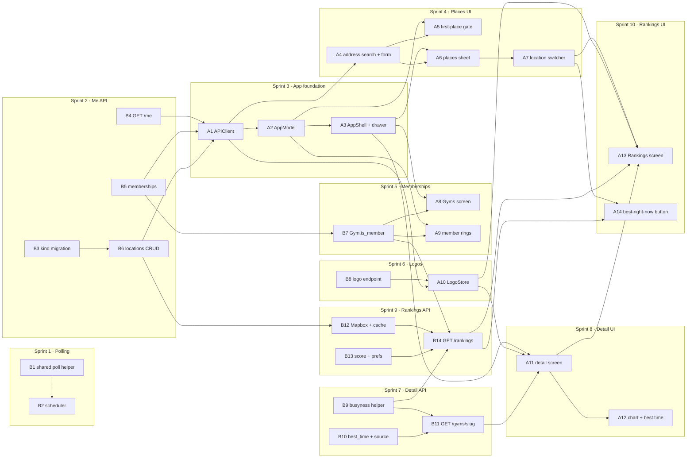

# Boulder Bay — v1 Sprints and Task Dependencies

This breaks `boulder_bay_v1_design.md` into small sprints and numbered tasks. The design says
*what* to build and why; this file says *in what order*. Section references (§) point to the
design doc.

- **Task IDs:** `B` is a backend task, `A` an app task. Each task is roughly one PR that passes
  CI on its own.
- **Dependencies are hard dependencies.** The task needs the other one's code or API contract
  to be merged first. Anything not linked can run in parallel.
- **A sprint is done** when every task in it has merged and its "done when" check passes against
  the hosted database.

### When a sprint is done

Closing a sprint is part of the sprint, not a follow-up. In the same change that finishes it:

1. **Check it off.** Tick each of its tasks and the sprint itself in the [checklist](#checklist).
   A task is ticked when its PR merges; the sprint is ticked only once its "done when" check
   passes.
2. **Write its entry in the [sprint log](#sprint-log)**, with two parts:
   - **What was done:** the parts that matter later, not a changelog. Name the PRs, any
     migration revision it applied, and anywhere the work differs from the design doc or this
     plan (a renamed route, a dropped field, a task split or merged).
   - **Findings for later sprints:** anything a future sprint needs to know before it starts:
     gotchas, contract details the next task depends on, assumptions that turned out wrong,
     work that was deferred and where it went. Name the sprint or task it affects (e.g. "affects
     B14"). Write "None" when there are none, so an empty section reads as checked, not
     forgotten.
3. **Read the log before starting a sprint.** Earlier findings override the plan below where
   they conflict; update the affected task row when they do.

---

## Checklist

- [ ] **Sprint 1 — Automatic polling**
  - [x] B1 Shared poll helper
  - [ ] B2 Scheduler
- [ ] **Sprint 2 — Profile, memberships and places API**
  - [x] B3 `saved_locations.kind` migration
  - [x] B4 `GET /api/me`
  - [x] B5 Memberships
  - [ ] B6 Saved locations CRUD
- [ ] **Sprint 3 — App foundation**
  - [ ] A1 `APIClient`
  - [ ] A2 `AppModel`
  - [ ] A3 `AppShell` + drawer
- [ ] **Sprint 4 — Places in the app**
  - [ ] A4 Address search + place form
  - [ ] A5 First-place gate
  - [ ] A6 Places sheet
  - [ ] A7 Location switcher
- [ ] **Sprint 5 — Memberships**
  - [ ] B7 `Gym.is_member`
  - [ ] A8 Gyms screen
  - [ ] A9 Member pin rings
- [ ] **Sprint 6 — Logos**
  - [x] B8 Logo endpoint
  - [ ] A10 `LogoStore` + `LogoImage`
- [ ] **Sprint 7 — Gym detail, backend**
  - [x] B9 Shared busyness helper
  - [x] B10 `best_time()` + `ForecastPoint.source`
  - [ ] B11 `GET /api/gyms/{slug}`
- [ ] **Sprint 8 — Gym detail, app**
  - [ ] A11 Detail screen
  - [ ] A12 Forecast chart + best-time card
- [ ] **Sprint 9 — Rankings, backend**
  - [ ] B12 Mapbox client + travel-time cache
  - [x] B13 `score()` + ranking prefs
  - [ ] B14 `GET /api/rankings`
- [ ] **Sprint 10 — Rankings, app**
  - [ ] A13 Rankings screen
  - [ ] A14 Best-right-now button
- [ ] **Sprint 11 — v1 wrap-up**
  - [ ] X1 On-device walkthrough
  - [ ] X2 Docs marked as built
  - [ ] X3 *(optional)* `last_successful_poll_at` on `/health`

---

## Sprints

### Sprint 1 — Automatic polling
**Goal:** snapshots start accumulating on their own. **Done when:** a FastAPI run with
`SCHEDULER_ENABLED=true` writes snapshots at :00 and :30 for open gyms only.

| ID | Task | Depends on | Design |
|---|---|---|---|
| B1 | Move `load_gyms` into `scrape/poll.py`; extract a shared "load → filter open → poll" helper; CLI uses it and gains `--open-only` | — | §8 |
| B2 | `scrape/scheduler.py`: tick truncation, open-gym filter, `poll_tick` that never raises; `lifespan` wiring; `SCHEDULER_ENABLED` setting; README run notes (one worker, no `--reload`) | B1 | §8 |

### Sprint 2 — Profile, memberships and places API
**Goal:** the three `/api/me` areas stop returning 501. **Done when:** every `/api/me` route
works against the hosted database, and the `kind` migration is applied and recorded in the docs.

| ID | Task | Depends on | Design |
|---|---|---|---|
| B3 | Migration: `saved_locations.kind` + one-home / one-work partial indexes; models, `test_models.py`, `backend/CLAUDE.md`, schema §2.7 / §8, root revision pointer | — | §3 |
| B4 | `GET /api/me` (`services/me.py`) | — | §4 |
| B5 | Memberships: `GET`, idempotent `POST` / `DELETE /{slug}`, 404 on unknown slug | — | §4 |
| B6 | Saved locations CRUD with `kind`: first place becomes default, promote order, last-place 409, delete-default promotion, lat/lng change clears `travel_times`, constraint-name → 409 messages | B3 | §4 |

### Sprint 3 — App foundation
**Goal:** the app has a real shell to put screens in. **Done when:** after signing in, the
hamburger menu switches between Map and two placeholder screens, and Sign out works from the
drawer.

| ID | Task | Depends on | Design |
|---|---|---|---|
| A1 | `APIClient`: `post` / `patch` / `delete`, 204 handling, `APIError.conflict`; typed calls for `/api/me`, memberships, locations; decoding tests | B4, B5, B6 | §9 Networking |
| A2 | `AppModel`: profile, locations, selected location, memberships, `selectedHour` (moved out of `MapViewModel`); `bootstrap()`; optimistic membership toggle | A1 | §9 Shared state |
| A3 | `AppShell`: `NavigationStack` + `AppRoute`, hamburger button, drawer (avatar, Sign out, Map / Rankings / Gyms rows), placeholder Rankings and Gyms screens; remove the temporary sign-out overlay; drawer snapshot test | A2 | §9 Root and shell |

### Sprint 4 — Places in the app
**Goal:** users can manage places, and a new user can't get past onboarding without adding one.
**Done when:** a fresh account adds a first place, then adds, edits, deletes and switches places
from both the drawer and the switcher.

| ID | Task | Depends on | Design |
|---|---|---|---|
| A4 | Address search (`MKLocalSearchCompleter` → `MKLocalSearch`) and the shared place form with the kind-availability rules | A1 | §9 Places |
| A5 | `FirstPlaceView` + the fourth `RootView` gate | A2, A4 | §9 Root and shell |
| A6 | `PlacesView` sheet: list, kind icons, default tag, swipe to delete (not on the last place), "Make default"; opened from the drawer's "Your places" row | A3, A4 | §9 Places |
| A7 | `LocationSwitcher` chip on the map, with "Edit places…" opening A6; the map flies to the chosen place | A6 | §9 Places |

### Sprint 5 — Memberships
**Goal:** the Gyms screen works, and member gyms stand out on the map. **Done when:** adding a
gym on the Gyms screen puts a clay ring on its pin.

| ID | Task | Depends on | Design |
|---|---|---|---|
| B7 | `Gym.is_member` on `/api/gyms` (contract change on both sides) | B5 | §10 |
| A8 | Gyms screen: "Your gyms" list, search over all 16, Add / Added toggles | A3, B7 | §9 Gyms screen |
| A9 | Member pin rings, with member pins drawn on top; update pin snapshots | A2, B7 | §9 Map additions |

### Sprint 6 — Logos
**Goal:** real logos everywhere a gym chip appears. **Done when:** logos load once per launch
and a repeat request returns 304.

| ID | Task | Depends on | Design |
|---|---|---|---|
| B8 | `GET /api/gyms/{slug}/logo` with ETag, 304, `Cache-Control`; fill in `logo_url` | — | §5 |
| A10 | `LogoStore` actor (in memory, no disk cache, deduplicated requests) and `LogoImage` with the initials placeholder and a tint option | A1, B8 | §9 Logos |

### Sprint 7 — Gym detail, backend
**Goal:** the detail endpoint stops returning 501. **Done when:**
`GET /api/gyms/{slug}?at=` returns hours, rates, links, a forecast and a best time that agree
with the map for the same `at`.

| ID | Task | Depends on | Design |
|---|---|---|---|
| B9 | Refactor: pull busyness loading and resolving out of `list_gyms` into a shared helper, keeping the query bound | — | §6 Refactor |
| B10 | `ForecastPoint.source`; `best_time()` as a pure function with table tests | — | §6 |
| B11 | `GET /api/gyms/{slug}`: the local day's forecast points and best time; 404 / 422 cases | B9, B10 | §6 |

### Sprint 8 — Gym detail, app
**Goal:** tapping a gym anywhere opens its detail screen. **Done when:** detail opens from the
map card and from the Gyms screen, and every section in design §9 renders.

| ID | Task | Depends on | Design |
|---|---|---|---|
| A11 | `GymDetailView` + view model; `GymRoute` destination on the shell; header, address → Apple Maps, hours, busyness, rates, waiver and website links; opened from the map card and Gyms rows | A3, A10, B11 | §9 Gym detail |
| A12 | Forecast chart (Swift Charts) and best-time card; detail snapshot tests | A11 | §9 Gym detail |

### Sprint 9 — Rankings, backend
**Goal:** rankings stop returning 501. **Done when:** rankings for a place return correct
scores, and still work with `MAPBOX_TOKEN` unset (fallback travel times).

| ID | Task | Depends on | Design |
|---|---|---|---|
| B12 | `services/travel.py`: Mapbox Matrix client, `travel_times` cache freshness, haversine fallback; `RANKING_RADIUS_METERS` setting | B6 | §7 Stage 2 |
| B13 | `services/ranking.py`: `score()` with mockup-number tests; lazy `ranking_prefs` row | — | §7 Scoring |
| B14 | `GET /api/rankings?location_id=`: `ST_DWithin` prefilter, the new one-location `Rankings` contract, `RankedGym.is_member` removed; 404 / 409 / default-location cases | B7, B9, B12, B13 | §7, §10 |

### Sprint 10 — Rankings, app
**Goal:** the core v1 feature. **Done when:** the Rankings screen and the map's best-pick
button agree for the same place and hour.

| ID | Task | Depends on | Design |
|---|---|---|---|
| A13 | Rankings screen: switcher + time header, best-pick card (tinted logo, "why" line), ranked rows that push detail, pull to refresh; snapshot tests | A7, A10, A11, B14 | §9 Rankings screen |
| A14 | Map "Best right now / Best at 7 PM" button: fetch rankings, select and fly to rank 1 | A7, B14 | §9 Map additions |

### Sprint 11 — v1 wrap-up
**Goal:** v1 is complete and the docs say so. **Done when:** a full walkthrough on a device
works, and nothing in the docs describes a 501.

| ID | Task | Depends on | Design |
|---|---|---|---|
| X1 | On-device walkthrough of every flow (sign up → first place → map → detail → gyms → rankings → sign out); fix what it finds | all above | — |
| X2 | Docs: README, both `CLAUDE.md` files, mark the plan and design as built | X1 | — |
| X3 | *(optional)* `last_successful_poll_at` on `/health` | B2 | §11 |

---

## Dependency tree

GitHub renders this diagram. Arrows point from a prerequisite to the task that needs it.



The same graph as a list. **Start here** marks tasks with no prerequisites; each arrow lists
what a task unblocks.

```text
Start here: B1, B3, B4, B5, B8, B9, B10, B13

B1  → B2
B3  → B6
B4  → A1
B5  → A1, B7
B6  → A1, B12
B7  → A8, A9, B14
B8  → A10
B9  → B11, B14
B10 → B11
B11 → A11
B12 → B14
B13 → B14
B14 → A13, A14
A1  → A2, A4, A10
A2  → A3, A5, A9
A3  → A6, A8, A11
A4  → A5, A6
A6  → A7
A7  → A13, A14
A10 → A11, A13
A11 → A12, A13
A13, A14, A12, A8, A9, A5, B2 → X1 → X2
B2  → X3 (optional)
```

## Critical path

The longest chain, and the sequence that sets the schedule:

```text
B3 → B6 → A1 → A2 → A3 → A6 → A7 → A13 → X1 → X2
```

Everything else can be done alongside it:

- **Backend, while the app track runs (sprints 3–4):** B1–B2, B7, B8, B9–B11, B12–B14. None of
  them waits on the app, so the backend for sprints 5–9 can be finished by the end of sprint 4.
- **App, off the critical path:** A4 can start as soon as A1 lands, alongside A2–A3. A8, A9, A10
  and A11 slot in once their backend task is merged.
- **Sprint 1 blocks nothing.** It goes first only so that data starts accumulating; it can move
  later without delaying anything.

---

## Sprint log

One entry per finished sprint, in the order they finished, following
[When a sprint is done](#when-a-sprint-is-done). A sprint with merged tasks but still open
work gets an *in progress* entry, which becomes its normal entry when the sprint closes. Use
this shape:

```markdown
### Sprint N — <name> (done YYYY-MM-DD)
**What was done:** …
**Findings for later sprints:** … (or "None")
```

*No sprints finished yet.* The in-progress entries below cover the eight backend tasks merged
into `claude/great-hamilton-jbc84m` on 2026-10-22 (not yet on `main`, no PRs yet).

### Sprint 1 — Automatic polling (in progress: B1 merged, B2 open)
**What was done:** B1. `load_gyms` moved into `app/scrape/poll.py`, and the new
`load_and_poll(session, open_provider, *, now, slugs=(), open_only=False, dry_run=False)`
does load → filter open → poll. The CLI calls it and gained `--open-only`. Not in the plan:
`PollSummary.no_data` is now false for an empty result list (`all([])` used to make it true,
a false DOM-change alarm whenever every gym was closed).

**Findings for later sprints:**
- Affects B2: `open_provider` is a factory, called only when at least one gym is to be
  polled, so an all-closed tick never launches Chromium. Pass the truncated tick as `now`;
  it is both the open-check instant and `observed_at`.
- Affects B2: `load_and_poll` commits after loading, so the read transaction doesn't idle
  through the scrape. `LookupError` (unknown slug) and `ProviderUnavailable` propagate, so
  `poll_tick` must catch them; log `summary.no_data` at ERROR too.
- `open_during` now lives in `app/services/busyness.py` (moved by B10); `poll.py` imports it.

### Sprint 2 — Profile, memberships and places API (in progress: B3, B4, B5 merged; B6 open)
**What was done:**
- B3: revision `75ffc45ed87e` (down: `b91e4d2c7a60`), hand-written. It adds
  `saved_locations.kind text not null default 'other'`, the check `saved_locations_kind_valid`,
  and the partial unique indexes `saved_locations_one_home_idx` / `saved_locations_one_work_idx`
  on `(user_id)`. Existing rows backfill as `other` through the default. **Written but not
  applied**: the hosted database is still at `b91e4d2c7a60`. Applying it is part of this
  sprint's done check.
- B4: `GET /api/me` via `app/services/me.py` (`get_profile`). It returns
  `{"data": {id, display_name}}`, or 404 `"Profile not found"` when the profile row is missing.
- B5: memberships. The service is in `app/services/memberships.py`, not `services/me.py` as
  §4 suggests. `GET /api/me/memberships` returns `{"data": [slug, ...]}` ordered by gym name,
  active gyms only. `POST` / `DELETE /api/me/memberships/{gym_slug}` return 204 with no body,
  are idempotent (`ON CONFLICT DO NOTHING`, and deleting a missing row is fine), and return
  404 `"Gym not found"` for an unknown or inactive slug. The service commits after each
  write, because `get_session` never commits.

**Findings for later sprints:**
- Affects B6: map these names to 409 messages: `saved_locations_one_home_idx`,
  `saved_locations_one_work_idx`, `saved_locations_kind_valid`, plus the existing
  `saved_locations_label_unique`. Commit inside the service, as B5 does.
- Affects B6: the `me` router still declares a router-wide 501 response, and
  `tests/test_api_contract.py` still expects 501 on the saved-location routes. Drop both once
  B6 lands, since they will be the last `me` stubs.
- Affects A1: the membership routes use the path parameter `gym_slug`, and writes return 204
  with an empty body.
- Tests check the SQL the code builds, not a real Postgres. Idempotency and the partial
  indexes are only proven once `75ffc45ed87e` is applied and the routes run against the
  hosted database.

### Sprint 6 — Logos (in progress: B8 merged, A10 open)
**What was done:** B8. `GET /api/gyms/{slug}/logo` serves `gym_logos` bytes with
`ETag: "<sha256>"`, `Cache-Control: private, max-age=86400` and `Content-Type` from the row.
`Gym.logo_url` is now an absolute URL to that route, or null for a gym without a logo.
Differences from §5: the route also 404s for an inactive gym, and the service takes a
`logo_url_for` callback instead of the `Request`.

**Findings for later sprints:**
- Affects A10: `If-None-Match` is compared weakly and accepts a list or `*`. A 304 has an empty
  body and repeats `ETag` and `Cache-Control`. The 404 (`"Gym logo not found"`) is checked
  before `If-None-Match`. The route needs the bearer token like every other route, so
  `LogoStore` must send it.

### Sprint 7 — Gym detail, backend (in progress: B9, B10 merged; B11 open)
**What was done:**
- B9: `load_busyness_inputs(session, gyms, *, at, now) -> BusynessInputs` in
  `app/services/gyms.py`. It takes three queries for any number of gyms (none for an empty
  list), and `BusynessInputs.resolve_for(gym)` resolves one gym. `list_gyms` uses it and is
  still four queries. Differences from §6: it lives in `services/gyms.py` rather than
  `services/busyness.py`, and `resolve_for` is a method.
- B10: `best_time(at, *, timezone, hours, curve) -> ForecastPoint | None` in
  `app/services/busyness.py`. It picks the lowest-`busy_pct` hour after `at`'s local hour,
  within the same local day, that is at least partly open and has a curve row. Ties go to the
  earliest hour, and 0% counts as data. `ForecastPoint.source` was added
  (`live` / `observed` / `forecast`, or null for a gap). `open_during` moved here from
  `scrape/poll.py`.

**Findings for later sprints:**
- Affects B11: `load_busyness_inputs` resolves one instant only. The day's forecast still
  needs its own curve query and snapshot query. `best_time`'s `curve` maps local hour →
  `busy_pct` for `at`'s local weekday. The naive-`at` `ValueError` stays in `list_gyms`;
  repeat it or factor it out.
- Affects A11 / A12: the Swift `ForecastPoint` has no `source` yet. Add
  `let source: BusynessSource?` and update the forecast fixtures in
  `APIResponseModelDecodingTests.swift`.

### Sprint 9 — Rankings, backend (in progress: B13 merged; B12, B14 open)
**What was done:** B13. `app/services/ranking.py` with the pure
`score(*, busy_pct, is_open, travel_minutes, is_member, weights=DEFAULT_WEIGHTS)`, which is
100 − w_crowd·crowd − w_travel·min(travel, cap) + member_boost − closed_penalty. A closed gym
has crowd 0, an open gym with unknown busyness counts as 50, and a closed member keeps the
boost. `RankingWeights.from_prefs(row)` converts the Decimal columns.
`get_or_create_ranking_prefs(session, user_id)` inserts with `ON CONFLICT DO NOTHING`, then
selects; it does not commit.

**Findings for later sprints:**
- Affects B14: fetch gyms with the `ST_DWithin` prefilter, then call `load_busyness_inputs`
  (B9) on them. Pass `RankingWeights.from_prefs(...)` to `score()`, and commit after
  `get_or_create_ranking_prefs` if it may have inserted. `score()` returns an unrounded float,
  so round it at the API layer if the contract needs that.
